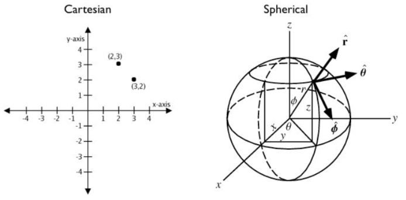

### 空间函数

空间函数中的大部分可以被归纳为以下五类：
* 转换：在geometry（PostGIS中存储空间信息的格式）和外部数据格式之间进行转换的函数
* 管理：管理关于空间表和PostGIS组织的信息的函数
* 检索：检索几何图形的属性和空间信息测量的函数
* 比较：比较两种几何图形的空间关系的函数
* 生成：基于其他几何图形生成新图形的函数


开放地理空间联盟(OGC)定义了简单功能访问标准(SFA)，以提供地理空间数据模型，postGIS将OGC几何模型实现为PostgreSQL数据类型geometry和geography。


geography采用的是地理坐标系（球面坐标），geometry是采用的是笛卡尔坐标系（平面坐标）
如果数据在地理范围上是紧凑的（包含在州、县或市内），请使用基于笛卡尔坐标的geometry类型。
如果你需要测量在地理范围上是分散的数据集（覆盖世界大部分地区）的距离，请使用geography类型。


### 4.1. 空间数据模型
#### 4.1.1. OGC几何图形
几何图形在二维笛卡尔平面上对形状进行建模。PolyhedralSurface, Triangle,和 TIN 也可以表示三维空间中的形状。形状的大小和位置由坐标指定。每个坐标都有 X 和 Y 坐标轴值，用于确定其在平面上的位置。形状由点和线构造，点由单个坐标定义，线由两个坐标定义。
几何维度是几何类型的属性。点类型的维度为0，线性类型的维度为1， 多边形类型的维度为2。
几何值与 空间参考系统指示它所嵌入的坐标系。空间参考系由几何SRID编号标识。X轴和Y轴的单位由空间参考系确定。平面参考系统中，X 和 Y 坐标通常表示东向和北向，而在 大地测量测量系统中，它们表示经度和纬度。SRID 0 表示一个具有无单位的无限笛卡尔平面

##### 点（Point）
点是表示坐标空间中单个位置的 0 维几何图形。
坐标可能包含可选的Z和M纵坐标值。Z纵坐标通常用于表示高程。M纵坐标包含一个测量值，该值可能表示时间或距离。如果几何值中存在Z或M值，则必须为几何中的每个点定义这些值。如果几何具有 Z 或 M 纵坐标，则坐标尺寸为 3D;如果它同时具有 Z 和 M，则坐标尺寸为 4D。
```
POINT (1 2)
POINT Z (1 2 3)
POINT ZM (1 2 3 4)
```
##### 线串（LineString）
线串是由连续的线段序列形成的一维线。每条线段由两个点定义，一条线段的终点形成下一条线段的起点。OGC 有效的 线串具有零个或两个或多个点，但 PostGIS 也允许单点线串。线串可以与自身交叉（自相交）。如果起点和终点相同，则线串是闭合的。如果线串不自相交，则它是简单的。
```
LINESTRING (1 2, 3 4, 5 6)
```

##### 线性环（LinearRing）
线性环是一个既封闭又简单的线串。第一个点和最后一个点必须相等，并且线不得自相交。
```
LINEARRING (0 0 0, 4 0 0, 4 4 0, 0 4 0, 0 0 0)
```

##### 多边形（Polygon）
多边形是由外部边界(壳)和零个或多个内部边界(洞)分隔的二维平面区域。每个边界都是 线性环。
```
POLYGON ((0 0 0,4 0 0,4 4 0,0 4 0,0 0 0),(1 1 0,2 1 0,2 2 0,1 2 0,1 1 0))
```

##### 多点（MultiPoint）
多点是点的集合。
```
MULTIPOINT ( (0 0), (1 2) )

```

##### 多线（MultiLineString）
多线是线串的集合，如果多线的每个元素都已闭合，则该多线闭合。
```
MULTILINESTRING ( (0 0,1 1,1 2), (2 3,3 2,5 4) )
```

##### 多面（MultiPolygon）
多面是非重叠、不相邻多边形的集合。集合中的多边形只能在有限数量的点处接触。
```
MULTIPOLYGON (((1 5, 5 5, 5 1, 1 1, 1 5)), ((6 5, 9 1, 6 1, 6 5)))
```
##### 几何集合（GeometryCollection）
几何集合是几何的异构（混合）集合。
```
GEOMETRYCOLLECTION ( POINT(2 3), LINESTRING(2 3, 3 4))
```

##### 多面体曲面（PolyhedralSurface）
多面体曲面是共享一些边的斑块或刻面的连续集合。每个面片都是一个平面多边形。如果多边形坐标具有 Z 纵坐标，则表面是三维的。
```
POLYHEDRALSURFACE Z (
  ((0 0 0, 0 0 1, 0 1 1, 0 1 0, 0 0 0)),
  ((0 0 0, 0 1 0, 1 1 0, 1 0 0, 0 0 0)),
  ((0 0 0, 1 0 0, 1 0 1, 0 0 1, 0 0 0)),
  ((1 1 0, 1 1 1, 1 0 1, 1 0 0, 1 1 0)),
  ((0 1 0, 0 1 1, 1 1 1, 1 1 0, 0 1 0)),
  ((0 0 1, 1 0 1, 1 1 1, 0 1 1, 0 0 1)) )
```

##### 三角形（Triangle）
三角形是由三个不同的非共线顶点定义的多边形。因为三角形是一个多边形，所以它由四个坐标指定，第一和第四个相等。
```
TRIANGLE ((0 0, 0 9, 9 0, 0 0))
```
##### TIN
TIN是一组不重叠的三角形，表示了一个三角不规则网络（Triangulated Irregular Network）的结构。
```
TIN Z ( ((0 0 0, 0 0 1, 0 1 0, 0 0 0)), ((0 0 0, 0 1 0, 1 1 0, 0 0 0)) )
```


### 4.1.2. SQL/MM第3部分-曲线
ISO/IEC 13249-3 SQL多媒体-空间标准 （SQL/MM）扩展了 OGC SFA 以定义包含弯曲几何图形的子类型。SQL/MM 类型支持 XYM、XYZ 和 XYZM。
#### 4.1.2.1. 圆弧串（CircularString）
圆弧串是基本曲线类型，类似于线性世界中的线串。单个圆弧段由三个点指定：起点和终点（第一个和第三个）以及圆弧上的其他点。 要指定闭合圆，起点和终点相同，中点是圆直径上的相对点（即圆弧的中心）。在弧序列中，前一个弧的终点是下一个弧的起点，就像线串的线段一样。 这意味着圆弧串必须具有大于 1 的奇数个点。
```
CIRCULARSTRING(0 0, 1 1, 1 0)
CIRCULARSTRING(0 0, 4 0, 4 4, 0 4, 0 0)
```
#### 4.1.2.2. 复合曲线（CompoundCurve）
复合曲线是一条连续曲线，可以包含圆弧段和线性段。意味着除了具有格式良好的组件之外，每个组件（最后一个除外）的终点必须与后续组件的起点重合。
```
COMPOUNDCURVE( CIRCULARSTRING(0 0, 1 1, 1 0),(1 0, 0 1))
```

#### 4.1.2.3. 曲线多边形（CurvePolygon）
曲线多边形与多边形相似，因为它们有一个外环和零个或多个内环。区别在于多边形环是线串，而曲线多边形环是复合曲线或圆弧串。
从PostGIS 1.4开始，PostGIS 现在支持曲线多边形上的复合曲线。
```
CURVEPOLYGON(
  CIRCULARSTRING(0 0, 4 0, 4 4, 0 4, 0 0),
  (1 1, 3 3, 3 1, 1 1) )
```
示例：具有由圆弧串和线串组成的复合曲线定义的外壳的曲线多边形，以及由圆弧串定义的孔
```
CURVEPOLYGON(
  COMPOUNDCURVE( CIRCULARSTRING(0 0,2 0, 2 1, 2 3, 4 3),
                 (4 3, 4 5, 1 4, 0 0)),
  CIRCULARSTRING(1.7 1, 1.4 0.4, 1.6 0.4, 1.6 0.5, 1.7 1) )
```

#### 4.1.2.4. 多曲线（MultiCurve）
多曲线是曲线的集合，可以包括线串、圆弧串或复合曲线。
```
MULTICURVE( (0 0, 5 5), CIRCULARSTRING(4 0, 4 4, 8 4))
```

#### 4.1.2.5. 多曲面（MultiSurface）
多曲面是曲面的集合，可以是（线性的）多边形或曲线多边形。
```
MULTISURFACE(
  CURVEPOLYGON(
    CIRCULARSTRING( 0 0, 4 0, 4 4, 0 4, 0 0),
    (1 1, 3 3, 3 1, 1 1)),
  ((10 10, 14 12, 11 10, 10 10), (11 11, 11.5 11, 11 11.5, 11 11)))
```

### 4.1.3. WKT和WKB
OGC SFA规范定义了两种标准格式，用于表示供外部使用的几何值。已知文本（WKT）和已知二进制文件（WKB）。WKT和WKB都包含有关定义对象的类型和坐标的信息。

已知文本（WKT）提供空间数据的标准字符表示形式。以下是空间对象的 WKT 表示形式示例：
POINT(0 0)
POINT Z (0 0 0)
POINT ZM (0 0 0 0)
POINT EMPTY
LINESTRING(0 0,1 1,1 2)
LINESTRING EMPTY
POLYGON((0 0,4 0,4 4,0 4,0 0),(1 1, 2 1, 2 2, 1 2,1 1))
MULTIPOINT((0 0),(1 2))
MULTIPOINT Z ((0 0 0),(1 2 3))
MULTIPOINT EMPTY
MULTILINESTRING((0 0,1 1,1 2),(2 3,3 2,5 4))
MULTIPOLYGON(((0 0,4 0,4 4,0 4,0 0),(1 1,2 1,2 2,1 2,1 1)), ((-1 -1,-1 -2,-2 -2,-2 -1,-1 -1)))
GEOMETRYCOLLECTION(POINT(2 3),LINESTRING(2 3,3 4))
GEOMETRYCOLLECTION EMPTY

已知二进制 （WKB） 是空间数据二进制数据（字节数组）的可移植且准确的表示形式。空间对象的 WKB 表示如下所示：
```
WKT: POINT(1 1)
WKB: 0101000000000000000000F03F000000000000F03
WKT: LINESTRING (2 2, 9 9)
WKB: 0102000000020000000000000000000040000000000000004000000000000022400000000000002240
```