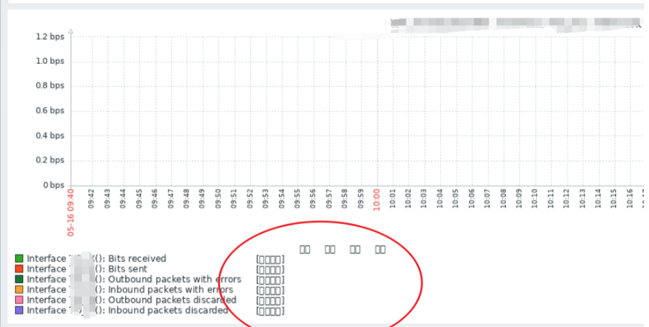
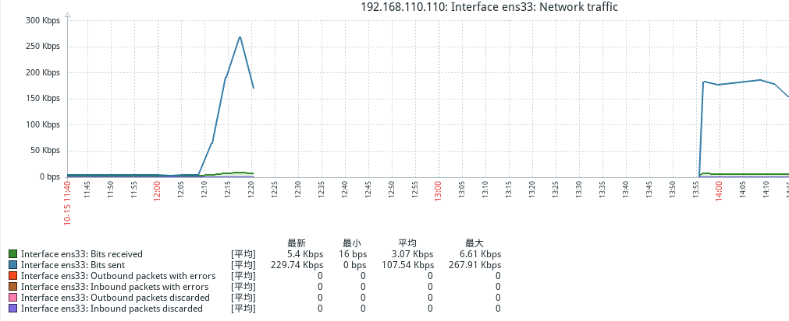
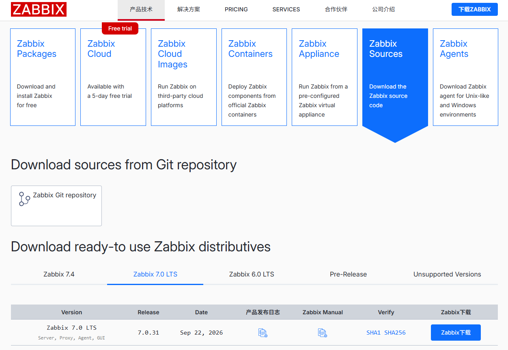

zabbix是一款基于web界面的提供分布式系统监控及网络监控的企业级开源解决方案，由多个组件构成。
* server：监控代理程序报告系统可用性、系统完整性和统计信息的核心组件
* agent：部署在监控目标机器上，监控本地资源程序，并将收集的信息发送给server
* web：为了从任何地方和任何平台都轻松的访问Zabbix，Zabbix提供了基于Web的界面；
* proxy：帮助server收信性能和可用性数据，proxy代理帮助单台server分担负载压力，分布式；
* db：数据存储在数据库中；
zabbix server通过SNMP、zabbix agent、ping 方法提供对远程服务器网络状态的监视，数据收集。


### 基础环境
```
CentOS Linux release 7.9.2009 (Core)


```

### 本地yum源
zabbix5.0离线安装，需要配置本地yum源，zabbix的yum源已下载好。
```
[root@localhost ~]# vim /etc/yum.repos.d/zabbix.repo
   [zabbix]
   name=zabbix
   baseurl=file:///tmp/offline_rpm
   gpgcheck=0
   enabled=1
[root@localhost ~]# mkdir /tmp/offline_rpm/
[root@localhost ~]# ll /tmp/offline_rpm/
   -rw-r--r--. 1 root root   106124 Oct 15 09:33 apr-1.4.8-7.el7.x86_64.rpm
   -rw-r--r--. 1 root root    94424 Oct 15 09:33 apr-util-1.5.2-6.el7_9.1.x86_64.rpm
   -rw-r--r--. 1 root root    78256 Oct 15 09:33 audit-libs-python-2.8.5-4.el7.x86_64.rpm
   -rw-r--r--. 1 root root    12308 Oct 15 09:33 centos-release-scl-2-3.el7.centos.noarch.rpm
   -rw-r--r--. 1 root root    12324 Oct 15 09:33 centos-release-scl-rh-2-3.el7.centos.noarch.rpm
   -rw-r--r--. 1 root root   302068 Oct 15 09:33 checkpolicy-2.5-8.el7.x86_64.rpm
   -rw-r--r--. 1 root root    65788 Oct 15 09:33 dejavu-fonts-common-2.33-6.el7.noarch.rpm
   -rw-r--r--. 1 root root  1482820 Oct 15 09:33 dejavu-sans-fonts-2.33-6.el7.noarch.rpm
   -rw-r--r--. 1 root root    10116 Oct 15 09:33 fontpackages-filesystem-1.44-8.el7.noarch.rpm
   -rw-r--r--. 1 root root    30928 Oct 15 09:33 fping-5.1-1.el7.x86_64.rpm
   -rw-r--r--. 1 root root  2849200 Oct 15 09:33 httpd-2.4.6-99.el7.centos.1.x86_64.rpm
   -rw-r--r--. 1 root root    96708 Oct 15 09:33 httpd-tools-2.4.6-99.el7.centos.1.x86_64.rpm
   -rw-r--r--. 1 root root    67720 Oct 15 09:33 libcgroup-0.41-21.el7.x86_64.rpm
   -rw-r--r--. 1 root root   219068 Oct 15 09:33 libevent-2.0.21-4.el7.x86_64.rpm
   -rw-r--r--. 1 root root   137752 Oct 15 09:33 libjpeg-turbo-1.2.90-8.el7.x86_64.rpm
   -rw-r--r--. 1 root root   115284 Oct 15 09:33 libsemanage-python-2.5-14.el7.x86_64.rpm
   -rw-r--r--. 1 root root   174472 Oct 15 09:33 libwebp-0.3.0-11.el7.x86_64.rpm
   -rw-r--r--. 1 root root   621640 Oct 15 09:33 libX11-1.6.7-4.el7_9.x86_64.rpm
   -rw-r--r--. 1 root root   168340 Oct 15 09:33 libX11-common-1.6.7-4.el7_9.noarch.rpm
   -rw-r--r--. 1 root root    29784 Oct 15 09:33 libXau-1.0.8-2.1.el7.x86_64.rpm
   -rw-r--r--. 1 root root   218900 Oct 15 09:33 libxcb-1.13-1.el7.x86_64.rpm
   -rw-r--r--. 1 root root    56964 Oct 15 09:33 libXpm-3.5.12-2.el7_9.x86_64.rpm
   -rw-r--r--. 1 root root    31264 Oct 15 09:33 mailcap-2.1.41-2.el7.noarch.rpm
   -rw-r--r--. 1 root root  9175948 Oct 15 09:33 mariadb-5.5.68-1.el7.x86_64.rpm
   -rw-r--r--. 1 root root 11761316 Oct 15 09:33 mariadb-server-5.5.68-1.el7.x86_64.rpm
   -rw-r--r--. 1 root root   769904 Oct 15 09:33 net-snmp-libs-5.7.2-49.el7_9.3.x86_64.rpm
   -rw-r--r--. 1 root root   248708 Oct 15 09:33 OpenIPMI-2.0.27-1.el7.x86_64.rpm
   -rw-r--r--. 1 root root   535796 Oct 15 09:33 OpenIPMI-libs-2.0.27-1.el7.x86_64.rpm
   -rw-r--r--. 1 root root    16368 Oct 15 09:33 OpenIPMI-modalias-2.0.27-1.el7.x86_64.rpm
   -rw-r--r--. 1 root root  8360316 Oct 15 09:33 perl-5.16.3-299.el7_9.x86_64.rpm
   -rw-r--r--. 1 root root    19672 Oct 15 09:33 perl-Carp-1.26-244.el7.noarch.rpm
   -rw-r--r--. 1 root root    33172 Oct 15 09:33 perl-Compress-Raw-Bzip2-2.061-3.el7.x86_64.rpm
   -rw-r--r--. 1 root root    58788 Oct 15 09:33 perl-Compress-Raw-Zlib-2.061-4.el7.x86_64.rpm
   -rw-r--r--. 1 root root    19244 Oct 15 09:33 perl-constant-1.27-2.el7.noarch.rpm
   -rw-r--r--. 1 root root    48296 Oct 15 09:33 perl-Data-Dumper-2.145-3.el7.x86_64.rpm
   -rw-r--r--. 1 root root   143612 Oct 15 09:33 perl-DBD-MySQL-4.023-6.el7.x86_64.rpm
   -rw-r--r--. 1 root root   821112 Oct 15 09:33 perl-DBI-1.627-4.el7.x86_64.rpm
   -rw-r--r--. 1 root root  1545440 Oct 15 09:33 perl-Encode-2.51-7.el7.x86_64.rpm
   -rw-r--r--. 1 root root    29092 Oct 15 09:33 perl-Exporter-5.68-3.el7.noarch.rpm
   -rw-r--r--. 1 root root    27088 Oct 15 09:33 perl-File-Path-2.09-2.el7.noarch.rpm
   -rw-r--r--. 1 root root    57680 Oct 15 09:33 perl-File-Temp-0.23.01-3.el7.noarch.rpm
   -rw-r--r--. 1 root root    78236 Oct 15 09:33 perl-Filter-1.49-3.el7.x86_64.rpm
   -rw-r--r--. 1 root root    57176 Oct 15 09:33 perl-Getopt-Long-2.40-3.el7.noarch.rpm
   -rw-r--r--. 1 root root    39292 Oct 15 09:33 perl-HTTP-Tiny-0.033-3.el7.noarch.rpm
   -rw-r--r--. 1 root root   266004 Oct 15 09:33 perl-IO-Compress-2.061-2.el7.noarch.rpm
   -rw-r--r--. 1 root root   706128 Oct 15 09:33 perl-libs-5.16.3-299.el7_9.x86_64.rpm
   -rw-r--r--. 1 root root    45324 Oct 15 09:33 perl-macros-5.16.3-299.el7_9.x86_64.rpm
   -rw-r--r--. 1 root root    52064 Oct 15 09:33 perl-Net-Daemon-0.48-5.el7.noarch.rpm
   -rw-r--r--. 1 root root    12592 Oct 15 09:33 perl-parent-0.225-244.el7.noarch.rpm
   -rw-r--r--. 1 root root    84468 Oct 15 09:33 perl-PathTools-3.40-5.el7.x86_64.rpm
   -rw-r--r--. 1 root root    36592 Oct 15 09:33 perl-PlRPC-0.2020-14.el7.noarch.rpm
   -rw-r--r--. 1 root root    53064 Oct 15 09:33 perl-Pod-Escapes-1.04-299.el7_9.noarch.rpm
   -rw-r--r--. 1 root root   114320 Oct 15 09:33 perl-podlators-2.5.1-3.el7.noarch.rpm
   -rw-r--r--. 1 root root    88756 Oct 15 09:33 perl-Pod-Perldoc-3.20-4.el7.noarch.rpm
   -rw-r--r--. 1 root root   221216 Oct 15 09:33 perl-Pod-Simple-3.28-4.el7.noarch.rpm
   -rw-r--r--. 1 root root    27436 Oct 15 09:33 perl-Pod-Usage-1.63-3.el7.noarch.rpm
   -rw-r--r--. 1 root root    36808 Oct 15 09:33 perl-Scalar-List-Utils-1.27-248.el7.x86_64.rpm
   -rw-r--r--. 1 root root    49868 Oct 15 09:33 perl-Socket-2.010-5.el7.x86_64.rpm
   -rw-r--r--. 1 root root    78888 Oct 15 09:33 perl-Storable-2.45-3.el7.x86_64.rpm
   -rw-r--r--. 1 root root    14056 Oct 15 09:33 perl-Text-ParseWords-3.29-4.el7.noarch.rpm
   -rw-r--r--. 1 root root    50392 Oct 15 09:33 perl-threads-1.87-4.el7.x86_64.rpm
   -rw-r--r--. 1 root root    39868 Oct 15 09:33 perl-threads-shared-1.43-6.el7.x86_64.rpm
   -rw-r--r--. 1 root root    46304 Oct 15 09:33 perl-Time-HiRes-1.9725-3.el7.x86_64.rpm
   -rw-r--r--. 1 root root    24792 Oct 15 09:33 perl-Time-Local-1.2300-2.el7.noarch.rpm
   -rw-r--r--. 1 root root   468316 Oct 15 09:33 policycoreutils-python-2.5-34.el7.x86_64.rpm
   -rw-r--r--. 1 root root    32880 Oct 15 09:33 python-IPy-0.75-6.el7.noarch.rpm
   -rw-r--r--. 1 root root     4380 Oct 15 09:33 rh-php72-1-2.el7.x86_64.rpm
   -rw-r--r--. 1 root root    61856 Oct 15 09:33 rh-php72-php-bcmath-7.2.24-1.el7.x86_64.rpm
   -rw-r--r--. 1 root root  3034776 Oct 15 09:33 rh-php72-php-cli-7.2.24-1.el7.x86_64.rpm
   -rw-r--r--. 1 root root   696228 Oct 15 09:33 rh-php72-php-common-7.2.24-1.el7.x86_64.rpm
   -rw-r--r--. 1 root root  1569352 Oct 15 09:33 rh-php72-php-fpm-7.2.24-1.el7.x86_64.rpm
   -rw-r--r--. 1 root root   154272 Oct 15 09:33 rh-php72-php-gd-7.2.24-1.el7.x86_64.rpm
   -rw-r--r--. 1 root root    55568 Oct 15 09:33 rh-php72-php-json-7.2.24-1.el7.x86_64.rpm
   -rw-r--r--. 1 root root    60820 Oct 15 09:33 rh-php72-php-ldap-7.2.24-1.el7.x86_64.rpm
   -rw-r--r--. 1 root root   565924 Oct 15 09:33 rh-php72-php-mbstring-7.2.24-1.el7.x86_64.rpm
   -rw-r--r--. 1 root root   170068 Oct 15 09:33 rh-php72-php-mysqlnd-7.2.24-1.el7.x86_64.rpm
   -rw-r--r--. 1 root root   103080 Oct 15 09:33 rh-php72-php-pdo-7.2.24-1.el7.x86_64.rpm
   -rw-r--r--. 1 root root   365308 Oct 15 09:33 rh-php72-php-pear-1.10.5-1.el7.noarch.rpm
   -rw-r--r--. 1 root root    63828 Oct 15 09:33 rh-php72-php-process-7.2.24-1.el7.x86_64.rpm
   -rw-r--r--. 1 root root   163908 Oct 15 09:33 rh-php72-php-xml-7.2.24-1.el7.x86_64.rpm
   -rw-r--r--. 1 root root    92208 Oct 15 09:33 rh-php72-php-zip-7.2.24-1.el7.x86_64.rpm
   -rw-r--r--. 1 root root  1203688 Oct 15 09:33 rh-php72-runtime-1-2.el7.x86_64.rpm
   -rw-r--r--. 1 root root    24976 Oct 15 09:33 scl-utils-20130529-19.el7.x86_64.rpm
   -rw-r--r--. 1 root root   635184 Oct 15 09:33 setools-libs-3.3.8-4.el7.x86_64.rpm
   -rw-r--r--. 1 root root   423152 Oct 15 09:33 unixODBC-2.3.1-14.el7.x86_64.rpm
   -rw-r--r--. 1 root root   503084 Oct 15 09:33 zabbix-agent-5.0.40-1.el7.x86_64.rpm
   -rw-r--r--. 1 root root    17696 Oct 15 09:33 zabbix-apache-conf-scl-5.0.40-1.el7.noarch.rpm
   -rw-r--r--. 1 root root  3330408 Oct 15 09:33 zabbix-server-mysql-5.0.40-1.el7.x86_64.rpm
   -rw-r--r--. 1 root root  3554260 Oct 15 09:33 zabbix-web-5.0.40-1.el7.noarch.rpm
   -rw-r--r--. 1 root root    18060 Oct 15 09:33 zabbix-web-deps-scl-5.0.40-1.el7.noarch.rpm
   -rw-r--r--. 1 root root    16792 Oct 15 09:33 zabbix-web-mysql-scl-5.0.40-1.el7.noarch.rpm
   drwxr-xr-x. 2 root root     4096 Oct 15 09:33 repodata
[root@localhost ~]# yum clean all
[root@localhost ~]# 
[root@localhost ~]# 
[root@localhost ~]# 
```

### 安装mysql

清除mariadb和mysql
```
[root@localhost ~]# rpm -qa|mysql
[root@localhost ~]# rpm -qa|mariadb
[root@localhost ~]# rpm -e mariadb-libs-5.5.68-1.el7.x86_64 --nodeps
[root@localhost ~]# 

```

安装mysql5.7
```
[root@localhost ~]# mysql-5.7.40-1.el7.x86_64.rpm-bundle.tar
   -rw-r--r--. 1 7155 31415  29373184 Aug 31  2022 mysql-community-client-5.7.40-1.el7.x86_64.rpm
   -rw-r--r--. 1 7155 31415    318744 Aug 31  2022 mysql-community-common-5.7.40-1.el7.x86_64.rpm
   -rw-r--r--. 1 7155 31415   4426916 Aug 31  2022 mysql-community-devel-5.7.40-1.el7.x86_64.rpm
   -rw-r--r--. 1 7155 31415  48198452 Aug 31  2022 mysql-community-embedded-5.7.40-1.el7.x86_64.rpm
   -rw-r--r--. 1 7155 31415  23317580 Aug 31  2022 mysql-community-embedded-compat-5.7.40-1.el7.x86_64.rpm
   -rw-r--r--. 1 7155 31415 133334684 Aug 31  2022 mysql-community-embedded-devel-5.7.40-1.el7.x86_64.rpm
   -rw-r--r--. 1 7155 31415   2744456 Aug 31  2022 mysql-community-libs-5.7.40-1.el7.x86_64.rpm
   -rw-r--r--. 1 7155 31415   1264356 Aug 31  2022 mysql-community-libs-compat-5.7.40-1.el7.x86_64.rpm
   -rw-r--r--. 1 7155 31415 187168492 Aug 31  2022 mysql-community-server-5.7.40-1.el7.x86_64.rpm
   -rw-r--r--. 1 7155 31415 127163468 Aug 31  2022 mysql-community-test-5.7.40-1.el7.x86_64.rpm
[root@localhost ~]# 
[root@localhost ~]# 
[root@localhost ~]# rpm -ivh mysql-community-common-5.7.40-1.el7.x86_64.rpm 
   warning: mysql-community-common-5.7.40-1.el7.x86_64.rpm: Header V4 RSA/SHA256 Signature, key ID 3a79bd29: NOKEY
   Preparing...                          ################################# [100%]
   Updating / installing...
      1:mysql-community-common-5.7.40-1.e################################# [100%]
[root@localhost ~]# rpm -ivh mysql-community-libs-5.7.40-1.el7.x86_64.rpm 
   warning: mysql-community-libs-5.7.40-1.el7.x86_64.rpm: Header V4 RSA/SHA256 Signature, key ID 3a79bd29: NOKEY
   Preparing...                          ################################# [100%]
   Updating / installing...
      1:mysql-community-libs-5.7.40-1.el7################################# [100%]
[root@localhost ~]# rpm -ivh mysql-community-libs-compat-5.7.40-1.el7.x86_64.rpm 
   warning: mysql-community-libs-compat-5.7.40-1.el7.x86_64.rpm: Header V4 RSA/SHA256 Signature, key ID 3a79bd29: NOKEY
   Preparing...                          ################################# [100%]
   Updating / installing...
      1:mysql-community-libs-compat-5.7.4################################# [100%]
[root@localhost ~]# rpm -ivh mysql-community-client-5.7.40-1.el7.x86_64.rpm 
   warning: mysql-community-client-5.7.40-1.el7.x86_64.rpm: Header V4 RSA/SHA256 Signature, key ID 3a79bd29: NOKEY
   Preparing...                          ################################# [100%]
   Updating / installing...
      1:mysql-community-client-5.7.40-1.e################################# [100%]
[root@localhost ~]# rpm -ivh mysql-community-server-5.7.40-1.el7.x86_64.rpm 
   warning: mysql-community-server-5.7.40-1.el7.x86_64.rpm: Header V4 RSA/SHA256 Signature, key ID 3a79bd29: NOKEY
   Preparing...                          ################################# [100%]
   Updating / installing...
      1:mysql-community-server-5.7.40-1.e################################# [100%]
```

启动mysql服务
```
[root@localhost ~]# systemctl start mysqld
[root@localhost ~]# systemctl enable mysqld
[root@localhost ~]# systemctl status mysqld
[root@localhost ~]# 
#查看密码
[root@localhost ~]# grep 'temporary password' /var/log/mysqld.log
   2026-10-13T04:59:15.921695Z 1 [Note] A temporary password is generated for root@localhost: RJkEoj0s_vO3
[root@localhost ~]# 
#修改密码
[root@localhost ~]# mysql -u root -p
   mysql>set password for root@'%'=password('123456');
   mysql> use mysql;
   mysql> update user set user.host='%' where user.user='root';
      Query OK, 1 row affected (0.00 sec)
   mysql> flush privileges;

   #创建用户
   mysql> CREATE USER 'root'@'%' IDENTIFIED BY '123456';
   mysql> GRANT ALL PRIVILEGES ON 数据库名.* TO '用户名'@'主机名';

   #创建zabbix数据库
   mysql> create database zabbix character set utf8 collate utf8_bin; 
   mysql> create user zabbix@localhost identified by '123456'; 
   mysql> grant all privileges on zabbix.* to zabbix@localhost; 
   mysql> #可选 grant all privileges on * .* to zabbix@'%' identified by 'password';
   mysql> FLUSH PRIVILEGES;
   mysql> 
[root@localhost ~]# 

```
 

### 安装zabbix

```
[root@localhost ~]# yum install zabbix-server-mysql -y
[root@localhost ~]# rpm -ivh fping-5.1-1.el7.x86_64.rpm 
[root@localhost ~]# yum install -y unixODBC
[root@localhost ~]# yum install -y OpenIPMI-libs
[root@localhost ~]# yum install zabbix-agent -y
[root@localhost ~]# yum install httpd -y
[root@localhost ~]# yum install rh-php72-php-fpm -y
[root@localhost ~]# yum install zabbix-web-mysql-scl -y
[root@localhost ~]# yum install zabbix-apache-conf-scl -y

# 安装字体
[root@localhost ~]# yum -y install wqy-microhei-fonts
[root@localhost ~]# cp /usr/share/fonts/wqy-microhei/wqy-microhei.ttc /usr/share/zabbix/assets/fonts/graphfont.ttf
   cp: overwrite ‘/usr/share/zabbix/assets/fonts/graphfont.ttf’? y
[root@localhost ~]# 
[root@localhost ~]# 

#启动服务
[root@localhost ~]# systemctl start zabbix-server zabbix-agent httpd rh-php72-php-fpm
[root@localhost ~]# systemctl enable zabbix-server zabbix-agent httpd rh-php72-php-fpm
[root@localhost ~]# systemctl status zabbix-server zabbix-agent httpd rh-php72-php-fpm
[root@localhost ~]# 


```
### 访问zabbix

默认账号：Amin/zabbix


```
汉字乱码
[root@localhost ~]# cd /usr/local/zabbix_web/include/
[root@localhost ~]# vim defines.inc.php 
   define('ZBX_FONTPATH',                          realpath('assets/fonts')); // where to search for font (GD > 2.0.18)
   define('ZBX_GRAPH_FONT_NAME',           'graphfont'); // font file name
[root@localhost ~]# cd /usr/local/zabbix_web/assets/fonts/
[root@localhost ~]# mv simkai.ttf  graphfont.ttf
```

### 常见报错

解决Zabbix启动报错Cannot bind socket to“/var/run/zabbix/zabbix_server_preprocessing.sock“: [13] Permission

```
# 关闭防火墙
[root@localhost ~]# vim /etc/selinux/config
   SELINUX=disabled
[root@localhost ~]# reboot

```

Time zone for PHP is not set (configuration parameter "date.timezone").
```
[root@localhost ~]# vim /etc/opt/rh/rh-php72/php-fpm.d/zabbix.conf
   php_value[date.timezone] = Asia/Shanghai
[root@localhost ~]# service httpd restart
[root@localhost ~]# reboot

```




### 配置zabbix


Kylin@123


