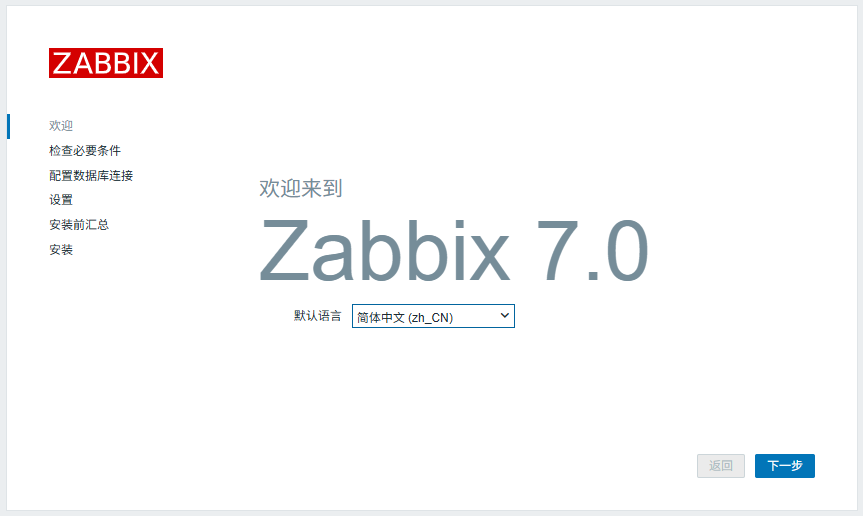
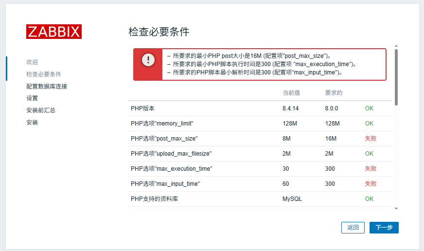
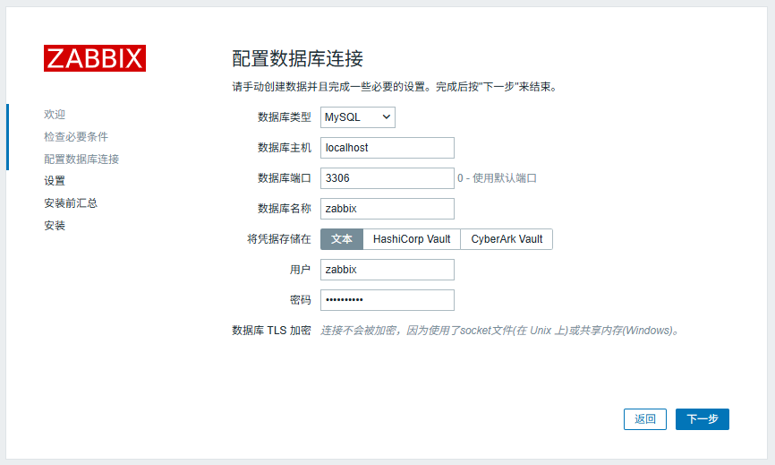
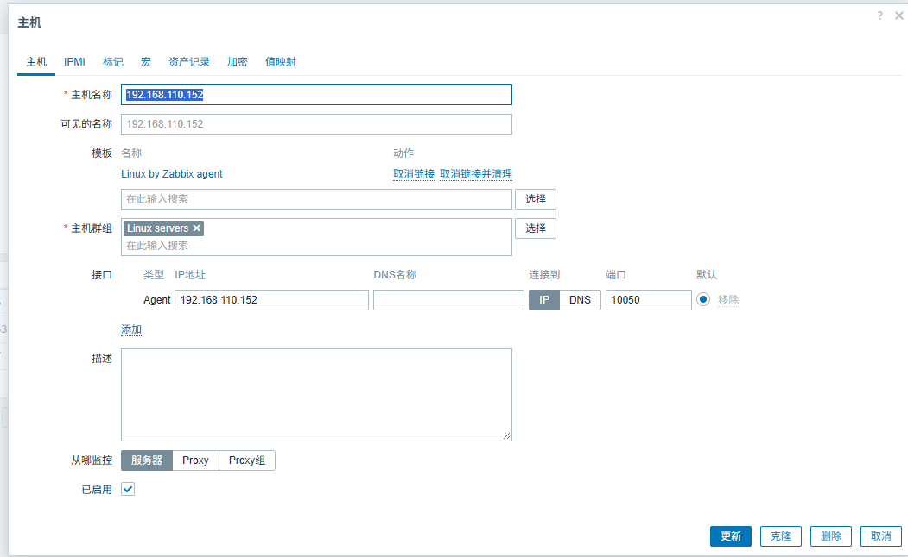
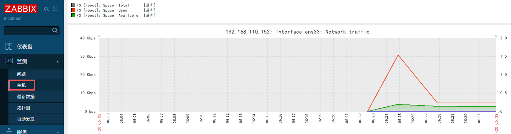

zabbix是一款基于web界面的提供分布式系统监控及网络监控的企业级开源解决方案，由多个组件构成。
* server：监控代理程序报告系统可用性、系统完整性和统计信息的核心组件
* agent：部署在监控目标机器上，监控本地资源程序，并将收集的信息发送给server
* web：为了从任何地方和任何平台都轻松的访问Zabbix，Zabbix提供了基于Web的界面；
* proxy：帮助server收信性能和可用性数据，proxy代理帮助单台server分担负载压力，分布式；
* db：数据存储在数据库中；
zabbix server通过SNMP、zabbix agent、ping 方法提供对远程服务器网络状态的监视，数据收集。


### 基础环境

* Kylin-Server-V10-SP3-2403-Release-20240426-x86_64
* mysql-8.3.0-1.el8.x86_64.rpm-bundle
* nginx-1.20.2
* php-8.4.14
* zabbix-7.0.31


### 安装方式
源码安装


关闭防火墙
systemctl stop firewalld
vim /etc/selinux/config
   SELINUX=disabled  # 永久关闭（需重启生效
 
### 安装nginx

```
[root@localhost ~]# cd /usr/local/src/mysql8.0/nginx-1.20.2
[root@localhost ~]# ./configure --prefix=/usr/local/nginx --with-http_ssl_module --with-http_stub_status_module --with-stream

   报错
   Configuration summary
   + using system PCRE library
   + using system OpenSSL library
   + using system zlib library
   nginx error log file: "/usr/local/nginx/logs/error.log"

[root@localhost ~]# yum install gcc-c++  -y
[root@localhost ~]# yum install pcre pcre-devel -y
[root@localhost ~]# yum install zlib zlib-devel -y
[root@localhost ~]# yum install openssl openssl-devel -y
[root@localhost ~]# make && make install
[root@localhost ~]# 

```


### 安装mysql
清除mariadb和mysql
```
[root@localhost ~]# rpm -qa|grep mariadb
   mariadb-common-10.3.39-1.p02.ky10.x86_64
   mariadb-errmessage-10.3.39-1.p02.ky10.x86_64
   mariadb-10.3.39-1.p02.ky10.x86_64
   mariadb-connector-c-3.0.6-9.ky10.x86_64
   mariadb-server-10.3.39-1.p02.ky10.x86_64
[root@localhost ~]# rpm -e mariadb-connector-c-3.0.6-9.ky10.x86_64  --nodeps
[root@localhost ~]# rpm -e mariadb-10.3.39-1.p02.ky10.x86_64 --nodeps
[root@localhost ~]# rpm -e mariadb-errmessage-10.3.39-1.p02.ky10.x86_64 --nodeps
[root@localhost ~]# rpm -e mariadb-connector-c-3.0.6-9.ky10.x86_64 --nodeps
[root@localhost ~]# rpm -e mariadb-server-10.3.39-1.p02.ky10.x86_64 --nodeps
[root@localhost ~]# rpm -qa|grep mysql
[root@localhost ~]# rpm -e python2-mysqlclient-1.3.12-8.ky10.x86_64
[root@localhost ~]# rpm -e qt5-qtbase-mysql-5.11.1-20.p01.ky10.x86_64 --nodeps
#安装mysql-8.3.0-1
[root@localhost ~]# tar -xvf mysql-8.3.0-1.el8.x86_64.rpm-bundle.tar
   -rw-r--r-- 1 7155 31415  16941448 mysql-community-client-8.3.0-1.el8.x86_64.rpm
   -rw-r--r-- 1 7155 31415  34752752 mysql-community-client-debuginfo-8.3.0-1.el8.x86_64.rpm
   -rw-r--r-- 1 7155 31415   5969576 mysql-community-client-plugins-8.3.0-1.el8.x86_64.rpm
   -rw-r--r-- 1 7155 31415   5644284 mysql-community-client-plugins-debuginfo-8.3.0-1.el8.x86_64.rpm
   -rw-r--r-- 1 7155 31415    700872 mysql-community-common-8.3.0-1.el8.x86_64.rpm
   -rw-r--r-- 1 7155 31415   4082264 mysql-community-debuginfo-8.3.0-1.el8.x86_64.rpm
   -rw-r--r-- 1 7155 31415  25596640 mysql-community-debugsource-8.3.0-1.el8.x86_64.rpm
   -rw-r--r-- 1 7155 31415   8626564 mysql-community-devel-8.3.0-1.el8.x86_64.rpm
   -rw-r--r-- 1 7155 31415   2347844 mysql-community-icu-data-files-8.3.0-1.el8.x86_64.rpm
   -rw-r--r-- 1 7155 31415   1585760 mysql-community-libs-8.3.0-1.el8.x86_64.rpm
   -rw-r--r-- 1 7155 31415   2786624 mysql-community-libs-debuginfo-8.3.0-1.el8.x86_64.rpm
   -rw-r--r-- 1 7155 31415  68220248 mysql-community-server-8.3.0-1.el8.x86_64.rpm
   -rw-r--r-- 1 7155 31415  26680212 mysql-community-server-debug-8.3.0-1.el8.x86_64.rpm
   -rw-r--r-- 1 7155 31415 164070268 mysql-community-server-debug-debuginfo-8.3.0-1.el8.x86_64.rpm
   -rw-r--r-- 1 7155 31415 251764976 mysql-community-server-debuginfo-8.3.0-1.el8.x86_64.rpm
   -rw-r--r-- 1 7155 31415 381011996 mysql-community-test-8.3.0-1.el8.x86_64.rpm
   -rw-r--r-- 1 7155 31415  28973688 mysql-community-test-debuginfo-8.3.0-1.el8.x86_64.rpm
[root@localhost ~]# 
[root@localhost ~]# rpm -ivh mysql-community-common-8.3.0-1.el8.x86_64.rpm 
[root@localhost ~]# rpm -ivh mysql-community-client-plugins-8.3.0-1.el8.x86_64.rpm 
[root@localhost ~]# rpm -ivh mysql-community-libs-8.3.0-1.el8.x86_64.rpm 
[root@localhost ~]# rpm -ivh mysql-community-client-8.3.0-1.el8.x86_64.rpm 
[root@localhost ~]# rpm -ivh mysql-community-devel-8.3.0-1.el8.x86_64.rpm 
[root@localhost ~]# rpm -ivh mysql-community-icu-data-files-8.3.0-1.el8.x86_64.rpm 
[root@localhost ~]# rpm -ivh mysql-community-server-8.3.0-1.el8.x86_64.rpm 
   警告：mysql-community-server-8.3.0-1.el8.x86_64.rpm: 头V4 RSA/SHA256 Signature, 密钥 ID a8d3785c: NOKEY
   Verifying...                          ################################# [100%]
   准备中...                          ################################# [100%]
   正在升级/安装...
      1:mysql-community-server-8.3.0-1.el################################# [100%]

#启动mysql
[root@localhost ~]# systemctl start mysqld
[root@localhost ~]# systemctl enable mysql
[root@localhost ~]# systemctl satus mysqld
#查看登录密码
[root@localhost ~]# cat /var/log/mysqld.log | grep root@localhost
    [Note] [MY-010454] [Server] A temporary password is generated for root@localhost: wp%!wc/**5Qf
    
[root@localhost ~]# mysql -u root -p
   mysql> show databases;
   ERROR 1820 (HY000): You must reset your password using ALTER USER statement before executing this statement.
   mysql> alter user root@localhost identified by 'Root@123';
   mysql> use mysql;
   mysql> update user set host='%' where user='root';
   mysql> flush privileges;
   mysql> set global log_bin_trust_function_creators = 1;
   mysql> create database zabbix character set utf8 collate utf8_bin;
   mysql> create user zabbix@'localhost' identified by 'Zabbix@123'; 
   mysql> grant all on zabbix.* to zabbix@localhost ;
   mysql>  FLUSH PRIVILEGES; 

[root@localhost ~]#
[root@localhost ~]#
[root@localhost ~]#
```

### 安装php

```
[root@localhost ~]# rpm -ivh fping-5.1-1.el7.x86_64.rpm
[root@localhost ~]# unxz php-8.4.14.tar.xz 
[root@localhost ~]# tar -xvf php-8.4.14.tar 
[root@localhost ~]# cd php-8.4.14
[root@localhost ~]# yum install re2c -y
[root@localhost ~]# yum install bison -y
[root@localhost ~]# yum install autoconf -y
[root@localhost ~]# yum install make -y
[root@localhost ~]# yum install libtool -y
[root@localhost ~]# yum install ccache -y
[root@localhost ~]# yum install libxml2-devel -y
[root@localhost ~]# yum install curl-devel -y
[root@localhost ~]# yum install openssl-devel -y
[root@localhost ~]# yum install bzip2-devel -y
[root@localhost ~]# yum install libcurl-devel -y
[root@localhost ~]# yum install libpng-devel -y
[root@localhost ~]# yum install libwebp-devel -y
[root@localhost ~]# yum install libjpeg-devel -y
[root@localhost ~]# yum install oniguruma-devel -y
[root@localhost ~]# yum install libzip-devel -y
[root@localhost ~]# yum install freetype-devel -y
[root@localhost ~]# yum install sqlite-devel -y
[root@localhost ~]# yum install gettext-devel

#这几个装不了
[root@localhost ~]# yum install re2c -y
[root@localhost ~]# yum install ccache -y
[root@localhost ~]# yum install oniguruma-devel -y
[root@localhost ~]# yum install libzip-devel -y
[root@localhost ~]#

#安装 oniguruma
[root@localhost ~]# tar -zxvf oniguruma-6.9.4.tar.gz
[root@localhost ~]# cd oniguruma-6.9.4 
[root@localhost ~]# ./autogen.sh && ./configure --prefix=/usr  --libdir=/lib64
[root@localhost ~]# make && make install
[root@localhost ~]#


报错
configure: error: Package requirements (libzip >= 0.11 libzip != 1.3.1 libzip != 1.7.0) were not met:
[root@localhost ~]# tar xvf libzip-1.3.2.tar.gz
[root@localhost ~]# cd libzip-1.3.2
[root@localhost ~]# ./configure && make && make install
[root@localhost ~]# export PKG_CONFIG_PATH="/usr/local/lib/pkgconfig/" 
[root@localhost ~]# 
[root@localhost ~]# 

# 安装php 
[root@localhost ~]# cd php-8.4.14/
[root@localhost ~]# ./configure \
  --prefix=/usr/local/php \
  --with-config-file-path=/usr/local/php/etc \
  --enable-fpm \
  --enable-mbstring \
  --with-curl \
  --with-openssl \
  --with-zlib \
  --with-mysqli \
  --with-pdo-mysql \
  --enable-gd \
  --with-jpeg \
  --with-webp \
  --with-freetype \
  --with-zip \
  --with-gettext \
  --with-bz2 \
  --enable-bcmath \
  --enable-sockets
[root@localhost ~]# make  -j `nproc`  && echo $? 
[root@localhost ~]# make install  && echo $? 
[root@localhost ~]# useradd -r  -M -s /sbin/nologin www
[root@localhost ~]# cp ./php.ini-production /usr/local/php/etc/php.ini

[root@localhost ~]# cd /usr/local/php/
[root@localhost ~]# cp ./etc/php-fpm.conf.default ./etc/php-fpm.conf
[root@localhost ~]# cp ./etc/php-fpm.d/www.conf.default ./etc/php-fpm.d/www.conf
[root@localhost ~]# 
[root@localhost ~]# echo 'export PATH=${PATH}:/usr/local/php/bin:/usr/local/php/sbin' >> /etc/profile
[root@localhost ~]# source /etc/profile
[root@localhost ~]# php -m && php -v
[root@localhost ~]#
[root@localhost ~]#
#配置php启动
[root@localhost ~]# vim /usr/lib/systemd/system/php-fpm.service
   [Unit]
   Description=The PHP FastCGI Process Manager
   After=syslog.target network.target

   [Service]
   Type=simple
   PIDFile=/usr/local/php/var/run/php-fpm.pid
   ExecStart=/usr/local/php/sbin/php-fpm --nodaemonize --fpm-config /usr/local/php/etc/php-fpm.conf
   ExecReload=/bin/kill -USR2 $MAINPID

   [Install]
   WantedBy=multi-user.target
[root@localhost ~]# systemctl daemon-reload
[root@localhost ~]# systemctl enable --now php-fpm
[root@localhost ~]# systemctl status php-fpm
[root@localhost ~]# systemctl start php-fpm
[root@localhost ~]# 

10月 19 13:22:34 localhost.localdomain php-fpm[210241]: [19-Oct-2026 13:22:34] ERROR: failed to open configuration file '/usr/local/php/etc/php-fpm.conf': No such file or director>
[root@localhost ~]#  chown www:www ./php/ -R
[root@localhost ~]# 
[root@localhost ~]# 

解决 PHP 不支持 BCMath 扩展的问题
/usr/local/src/php-8.4.14/ext/bcmath
./configure --with-php-config=/usr/local/php/bin/php-config
./configure --enable-bcmath
make && make install


PHP sockets 扩展不支持(PHP配置参数 --enable-sockets).
cd /usr/local/src/php-8.4.14/ext/sockets
cd php-5.3.8/ext/sockets/
/usr/local/php/bin/phpize
./configure --enable-sockets --with-php-config=/usr/local/php/bin/php-config
make && make install

```


### 安装zabbix

```
[root@localhost ~]# groupadd -g 2000 zabbix
[root@localhost ~]# useradd -g zabbix -u 2000 -s /sbin/nologin zabbix
[root@localhost ~]# cd /usr/local/src/zabbix-7.0.31
[root@localhost ~]# ./configure \
      --prefix=/usr/local/zabbix \
      --enable-server \
      --enable-agent \
      --with-mysql \
      --with-net-snmp \
      --with-libcurl \
      --with-ssl 
[root@localhost ~]# make && make install
##编译 源代码-->可执行文件(命令) 
make  -j `nproc`  && echo $? 
##安装 创建目录,复制文件
make install  && echo $?
[root@localhost ~]# chown zabbix:zabbix -R /usr/local/zabbix/
[root@localhost ~]# 
# 初始化sql脚本
[root@localhost ~]# /usr/local/src/zabbix-7.0.31/database/mysql
[root@localhost ~]# 
[root@localhost ~]# mysql -uzabbix -pxxxxxx zabbix < schema.sql
[root@localhost ~]# mysql -uzabbix -pxxxxxx zabbix < images.sql
[root@localhost ~]# mysql -uzabbix -pxxxxxx zabbix < data.sql
[root@localhost ~]# 
[root@localhost ~]# vim /usr/local/zabbix/etc/zabbix_server.conf
   DBName=zabbix      
   DBUser=zabbix      
   DBPassword=xxxxx
   LogFile=/var/log/zabbix/zabbix_server.log
   PidFile=/usr/local/zabbix/run/zabbix_server.pid
   Include=/usr/local/zabbix/etc/zabbix_server.conf.d/*.conf
[root@localhost ~]#
[root@localhost ~]# mkdir  /var/log/zabbix/
[root@localhost ~]# mkdir /usr/local/zabbix/run/
[root@localhost ~]# chown -R zabbix:zabbix /var/log/zabbix/
[root@localhost ~]# chown -R zabbix:zabbix /usr/local/zabbix/run/
[root@localhost ~]#
[root@localhost ~]# vim /usr/local/zabbix/etc/zabbix_agentd.conf
   LogFile=/var/log/zabbix/zabbix_agentd.log
   PidFile=/usr/local/zabbix/run/zabbix_agentd.pid
   Server=127.0.0.1
   ServerActive=127.0.0.1
   Hostname=Zabbix server
   Include=/usr/local/zabbix/etc/zabbix_agentd.conf.d/*.conf
[root@localhost ~]# 
[root@localhost ~]# 
[root@localhost ~]# vim /lib/systemd/system/zabbix_server.service
   [Unit]
   Description=Zabbix Server
   After=syslog.target
   After=network.target mysqld.service  #设置依赖于mysqld 不设置重启zabbix会启动不了卡住
   [Service]
   Environment="CONFFILE=/usr/local/zabbix/etc/zabbix_server.conf"
   EnvironmentFile=-/usr/local/zabbix
   Type=forking
   PIDFile=/usr/local/zabbix/run/zabbix_server.pid
   ExecStart=/usr/local/zabbix/sbin/zabbix_server -c /usr/local/zabbix/etc/zabbix_server.conf
   ExecStop=/usr/bin/kill  $MAINPID
   Restart=always
   RestartSec=5
   User=zabbix
   Group=zabbix
   [Install]
   WantedBy=multi-user.target
[root@localhost ~]# 
[root@localhost ~]# 
[root@localhost ~]# 
[root@localhost ~]# vim /lib/systemd/system/zabbix_agent.service
   [Unit]
   Description=Zabbix Agent 
   After=syslog.target
   After=network.target mysqld.service #设置依赖于mysqld 不设置重启zabbix会启动不了卡住
   [Service]
   Environment="CONFFILE=/usr/local/zabbix/etc/zabbix_agentd.conf"
   EnvironmentFile=-/usr/local/zabbix
   Type=forking
   PIDFile=/usr/local/zabbix/run/zabbix_agentd.pid
   ExecStart=/usr/local/zabbix/sbin/zabbix_agentd -c /usr/local/zabbix/etc/zabbix_agentd.conf
   ExecStop=/usr/bin/kill  $MAINPID
   Restart=always
   RestartSec=5
   User=zabbix
   Group=zabbix
   [Install]
   WantedBy=multi-user.target
[root@localhost ~]# 
[root@localhost ~]# 
[root@localhost ~]# systemctl enable --now zabbix_server.service zabbix_agent.service


configure: error: Invalid Net-SNMP directory - unable to find net-snmp-config
yum install -y net-snmp-devel

configure: error: Unable to use libevent (libevent check failed)
yum install -y libevent-devel
不行换这个
/usr/local/src/libevent-2.1.12-stable/
./configure --prefix=/usr/local
make && make install


ERROR 1419 (HY000) at line 2494: You do not have the SUPER privilege and binary logging is enabled (you *might* want to use the less safe log_bin_trust_function_creators variable)

error while loading shared libraries: libevent_core-2.1.so.7: cannot open shared
[root@localhost ~]# cat /etc/ld.so.conf
	include ld.so.conf.d/*.conf
[root@localhost ~]# echo "/usr/local/lib" >> /etc/ld.so.conf
[root@localhost ~]# ldconfig
```


### 配置nginx
```

[root@localhost ~]# vim /usr/local/nginx/conf/nginx.conf
   server {
      listen          8000;
      server_name     zabbixserver;
      access_log  /usr/local/nginx/logs/zabbix_access.log;
      error_log   /usr/local/nginx/logs/zabbix_error.log;
      root        /usr/local/zabbix_web/;
      index       index.php; 


      # 静态资源默认匹配规则
      location / {
         try_files	$uri $uri/ =404;
      }

      # 静态资源（assets目录）
      location /assets {
         access_log      off;
         expires         10d;
      }

      # 禁止访问 .htaccess 类文件
      location ~ /\.ht {
         deny            all;
      }

      # 禁止访问敏感目录
      location ~ /(api\/|conf[^\.]|include|locale) {
         deny            all;
         return          404;
      }

      # 禁止访问 vendor 目录
      location /vendor {
         deny            all;
         return          404;
      }

      # PHP 脚本解析核心配置
      location ~ [^/]\.php(/|$) {
         #如果你使用的是 socket unix:/var/run/php-fpm/www.sock
         fastcgi_pass    127.0.0.1:9000;
         
         fastcgi_split_path_info ^(.+\.php)(/.+)$;  
         fastcgi_index   index.php;  

         fastcgi_param   DOCUMENT_ROOT   /usr/local/zabbix_web/;
         fastcgi_param   SCRIPT_FILENAME /usr/local/zabbix_web/$fastcgi_script_name;
         fastcgi_param   PATH_TRANSLATED /usr/local/zabbix_web/$fastcgi_script_name;

         include fastcgi_params;  # 加载 Nginx 内置 fastcgi 参数
         # 传递核心请求参数
         fastcgi_param   QUERY_STRING    $query_string;
         fastcgi_param   REQUEST_METHOD  $request_method;
         fastcgi_param   CONTENT_TYPE    $content_type;
         fastcgi_param   CONTENT_LENGTH  $content_length;

         # PHP 连接/超时优化
         fastcgi_intercept_errors        on;
         fastcgi_ignore_client_abort     off;
         fastcgi_connect_timeout         60;
         fastcgi_send_timeout            180;
         fastcgi_read_timeout            180;
         fastcgi_buffer_size             128k;
         fastcgi_buffers                 4 256k;
         fastcgi_busy_buffers_size       256k;
         fastcgi_temp_file_write_size    256k;
      }
   }

```

yum install httpd -y
systemctl start httpd
systemctl enable httpd
systemctl status httpd


### 访问zabbix

默认账号：Amin/zabbix
http://192.168.110.150:8000/setup.php





```
所要求的最小PHP post大小是16M (配置项"post_max_size")。
所要求的最小PHP脚本执行时间是300 (配置项 "max_execution_time")。
所要求的PHP脚本最小解析时间是300 (配置项"max_input_time")。
[root@localhost ~]# cd /usr/local/php/etc
[root@localhost ~]# vim php.ini
   post_max_size = 16M
   max_execution_time = 300
   max_input_time = 300
[root@localhost ~]# systemctl restart php-fpm
[root@localhost ~]# 

```



### 常见报错

解决Zabbix启动报错Cannot bind socket to“/var/run/zabbix/zabbix_server_preprocessing.sock“: [13] Permission

```
# 关闭防火墙
[root@localhost ~]# vim /etc/selinux/config
   SELINUX=disabled
[root@localhost ~]# reboot

```

Time zone for PHP is not set (configuration parameter "date.timezone").
```
[root@localhost ~]# vim /etc/opt/rh/rh-php72/php-fpm.d/zabbix.conf
   php_value[date.timezone] = Asia/Shanghai
[root@localhost ~]# service httpd restart
[root@localhost ~]# reboot

```


```

报错： configure: error: MySQL library not found 
# find / -name "mysql_config"
/usr/local/mysql/bin/mysql_config

# ./configure --with-mysql=/usr/local/mysql/bin/mysql_config
2）报错：configure: error: LIBXML2 library not found

解决办法
# yum install libxml2-devel -y
3）报错：configure: error: Invalid Net-SNMP directory - unable to find net-snmp-config

解决办法
# yum install net-snmp-devel -y
4）报错：configure: error: Unable to use libevent (libevent check failed)

解决办法
# yum install libevent-devel -y
5）报错：configure: error: Curl library not found

解决办法
# yum install curl-devel -y
6）报错：configure: error: Unable to use libpcre (libpcre check failed)

解决办法
# yum install pcre* -y

```


### 安装监控主机zabbix_agent

```
[root@localhost ~]# cd /usr/local/src/zabbix-7.0.31
[root@localhost ~]# yum install curl-devel -y
[root@localhost ~]# yum install libcurl-devel -y
[root@localhost ~]# ./configure  --prefix=/usr/local/zabbix  --enable-agent --with-net-snmp  --with-libcurl --with-ssl 
[root@localhost ~]# make && make install
[root@localhost ~]# mkdir  /var/log/zabbix/
[root@localhost ~]# mkdir /usr/local/zabbix/run/
[root@localhost ~]# chown -R zabbix:zabbix /var/log/zabbix/
[root@localhost ~]# chown -R zabbix:zabbix /usr/local/zabbix/run/
[root@localhost ~]# 
[root@localhost ~]# 
[root@localhost ~]# vim /usr/local/zabbix/etc/zabbix_agentd.conf
   LogFile=/var/log/zabbix/zabbix_agentd.log
   PidFile=/usr/local/zabbix/run/zabbix_agentd.pid
   Server=zabbix_server_ip
   ServerActive=zabbix_server_ip:10050
   Hostname=Zabbix server
   Include=/usr/local/zabbix/etc/zabbix_agentd.conf.d/*.conf
[root@localhost ~]# 
[root@localhost ~]# 
[root@localhost ~]# vim /lib/systemd/system/zabbix_agent.service
   [Unit]
   Description=Zabbix Agent 
   After=syslog.target
   After=network.target mysqld.service #设置依赖于mysqld 不设置重启zabbix会启动不了卡住
   [Service]
   Environment="CONFFILE=/usr/local/zabbix/etc/zabbix_agentd.conf"
   EnvironmentFile=-/usr/local/zabbix
   Type=forking
   PIDFile=/usr/local/zabbix/run/zabbix_agentd.pid
   ExecStart=/usr/local/zabbix/sbin/zabbix_agentd -c /usr/local/zabbix/etc/zabbix_agentd.conf
   ExecStop=/usr/bin/kill  $MAINPID
   Restart=always
   RestartSec=5
   User=zabbix
   Group=zabbix
   [Install]
   WantedBy=multi-user.target
[root@localhost ~]# 
[root@localhost ~]# 
[root@localhost ~]# systemctl enable --now zabbix_server.service zabbix_agent.service
[root@localhost ~]# systemctl start zabbix_agent
[root@localhost ~]# 
```


