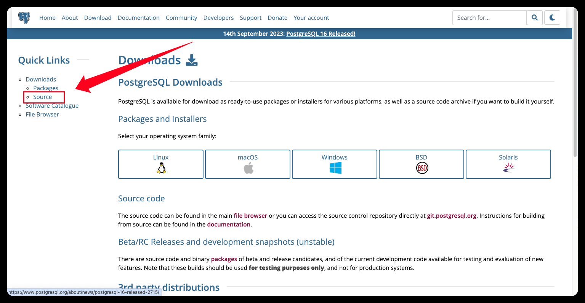
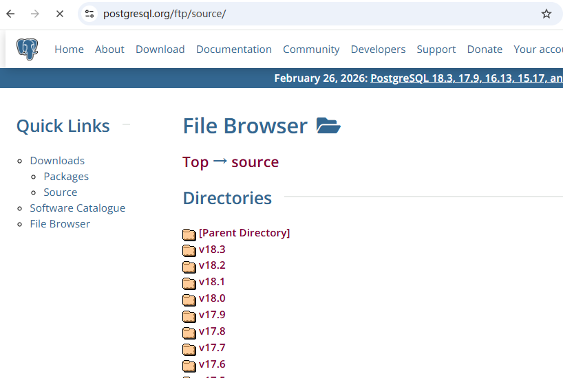
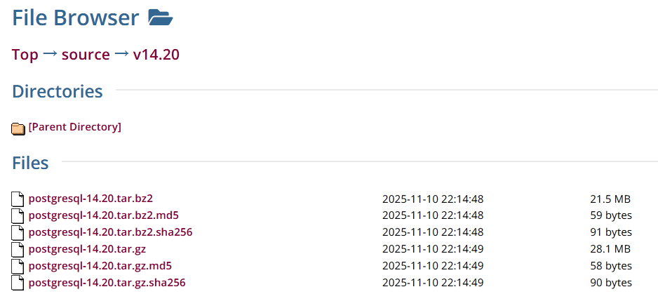

postgresql源码安装

### 下载安装文件
https://www.postgresql.org/download/




### 安装

```
[root@localhost ]# cd /usr/local/src/
[root@localhost ]# tar -zxvf postgresql-14.20.tar.gz
    -rw-r--r--  1 1107 1107    445 11月 11  2025 aclocal.m4
    drwxrwxrwx  2 1107 1107   4096 11月 11  2025 config
    -rw-r--r--  1 root root 419384 11月  6 15:15 config.log
    -rwxr-xr-x  1 root root  39774 11月  6 15:15 config.status
    -rwxr-xr-x  1 1107 1107 601673 11月 11  2025 configure
    -rw-r--r--  1 1107 1107  88540 11月 11  2025 configure.ac
    drwxrwxrwx 58 1107 1107   4096 11月 11  2025 contrib
    -rw-r--r--  1 1107 1107   1198 11月 11  2025 COPYRIGHT
    drwxrwxrwx  3 1107 1107     87 11月 11  2025 doc
    -rw-r--r--  1 root root   4279 11月  6 15:15 GNUmakefile
    -rw-r--r--  1 1107 1107   4279 11月 11  2025 GNUmakefile.in
    -rw-r--r--  1 1107 1107    277 11月 11  2025 HISTORY
    -rw-r--r--  1 1107 1107  63935 11月 11  2025 INSTALL
    -rw-r--r--  1 1107 1107   1665 11月 11  2025 Makefile
    -rw-r--r--  1 1107 1107   1213 11月 11  2025 README
    drwxrwxrwx 16 1107 1107   4096 11月  6 15:15 src
[root@localhost ]# 
[root@localhost ]# 
[root@localhost ]# 
#安装依赖包，需要特别注意的是，PG15及以上版本需要安装关于 Python3+ 的相关依赖包 python3 python3-devel
#默认安装目录/usr/local/pgsql/
[root@localhost ]# yum install -y readline-devel
[root@localhost ]# ./configure --without-readline
[root@localhost ]# make && make install
[root@localhost ]# 
#创建用户组
[root@localhost ]# groupadd postgres
[root@localhost ]# useradd -g postgres postgres
[root@localhost ]# id postgres
    uid=1000(postgres) gid=1000(postgres) groups=1000(postgres)
[root@localhost ]# 

#授权文件夹
[root@localhost ]# 
[root@localhost ]# 
[root@localhost ]# ./initdb -D /usr/local/pgsql/data/
[root@localhost ]# 

#设置相关环境变量
[root@localhost ]# vim /etc/profile
    PATH=$PATH:/usr/local/pgsql/bin
[root@localhost ]# source /etc/profile
[root@localhost ]# 
[root@localhost ]$ su - postgres
[root@localhost ]$ vim ~/.bash_profile 
    export PGHOME=/usr/local/pgsql
    export PGDATA=/usr/local/pgsql/data
    export PATH=$PATH:/usr/local/pgsql/bin
#初始数据库
[root@localhost ]$ su - postgres
[root@localhost ]$ cd /usr/local/pgsql/bin
[root@localhost ]$ ./initdb -D /usr/local/pgsql/data/
[root@localhost ]$ 
[root@localhost ]$ 
[root@localhost ]$ 

#开机自启
[root@localhost ]# vim /lib/systemd/system/zabbix_agent.service
[root@localhost ]# 
[root@localhost ]# 

```


### 其他

~\.bashrc是home目录下的一个shell文件，用于储存用户的个性化设置。在bash每次启动时都会加载.bashrc文件中的内容，并根据内容定制当前bash的配置和环境。
* .bash_history 记录之前输入的命令
* .bash_logout 当你退出时执行的命令
* .bash_profile 当你登入shell时执行
* .bashrc 当你登入shell时执行


-------------------------------------------

### PostgreSQL
PostgreSQL（简称PgSQL）是由加州大学伯克利分校开发的对象-关系型数据库管理系统，起源于1986年伯克利分校POSTGRES 4.2项目，基于该版本开发形成现有系统。支持SQL和JSON数据格式，广泛应用于Web、移动及地理空间数据分析领域。其具有事务完整性、多版本并发控制（MVCC）及ACID特性，可通过自定义数据类型、函数和插件架构实现功能扩展。
系统核心技术包括客户端-服务器架构、进程与共享内存管理机制，以及基于WAL的预写日志技术保障数据可靠性。PostgreSQL提供PostGIS扩展支持地理空间数据处理，通过并行查询和多种索引类型（B-Tree、GiST、GIN等）优化复杂查询性能。
类型：关系型数据库管理系统（RDBMS）

特点：
* 高级特性：支持大部分的SQL标准，并提供了很多其他现代特性，如复杂查询、外键、触发器、视图、事务完整性、多版本并发控制等高级特性
* 扩展性强：支持多种扩展，如全文搜索、地理空间数据处理等。
* 可定制性：高度可定制，支持用户自定义数据类型和函数。
* ACID事务支持：强一致性和事务支持。
* 开源：社区活跃，文档丰富。

适用场景：
* 复杂查询：需要执行复杂查询和分析的场景。
* 大数据量：适合处理大规模数据集。如物联网和大数据场景
* 企业级应用：需要高可靠性和一致性的企业级应用。适用于金融系统，可以确保数据的一致性和完整性
* 地理信息系统：支持地理空间数据处理，适合GIS应用。


### 安装包
本次安装版本为：postgresql-14.20.tar.gz
CentOS Linux release 7.9.2009 (Core)

```
下载地址：
linux 
https://www.postgresql.org/ftp/source/

window
https://www.enterprisedb.com/downloads/postgres-postgresql-downloads
```


安装文件说明：


* postgresql-14.20.tar.gz：源代码安装包，可用于手动编译和安装。
* postgresql-14.20.tar.gz.md5：用于验证下载文件的完整性，可以使用md5sum工具验证文件的md5值
* postgresql-14.20.tar.gz.sha256：用于验证下载文件的完整性，可以使用sha256sum工具验证文件的SHA-256值


### 安装过程


```
# 安装文件目录 /usr/local/src/postgresql-14.20.tar.gz
[root@localhost src]# tar -zxvf postgresql-14.20.tar.gz
[root@localhost src]# cd postgresql-14.20

# 安装依赖包
[root@localhost src]# yum install -y readline-devel
[root@localhost src]# 
[root@localhost src]# 
[root@localhost src]# 
```
可选依赖包

* perl-ExtUtils-Embed：这个包用于嵌入Perl代码到C程序中。在PostgreSQL中，它可能被用于某些与Perl相关的扩展或自定义脚本功能。
* readline-devel：这是readline库的开发版本，提供了命令行编辑和历史记录的功能。对于PostgreSQL，它使得使用交互式命令行工具（如psql）更加方便。
* zlib-devel：这是zlib压缩库的开发版本，用于数据压缩和解压缩。在PostgreSQL中，它用于优化数据存储和传输。
* pam-devel：这是Pluggable Authentication Modules（PAM）的开发包，用于集成多种认证技术。在PostgreSQL中，PAM可以用于用户认证。
* libxml2-devel：这是libxml2库的开发版本，它提供了XML的支持。在PostgreSQL中，它用于处理XML数据格式的功能。
* libxslt-devel：这是libxslt库的开发版本，用于XSLT转换。在PostgreSQL中，可能用于转换XML数据。
* openldap-devel：这是OpenLDAP的开发包，用于LDAP协议的支持。在PostgreSQL中，它可以用于集成LDAP-based的用户认证。
* python-devel：这是Python语言的开发包，可能用于支持Python编写的数据库脚本或扩展。
* gcc-c++：这是GNU C++编译器，用于编译C++代码。它可能用于编译PostgreSQL中的某些C++编写的部分或扩展。
* openssl-devel：这是OpenSSL库的开发版本，提供加密和SSL/TLS支持。在PostgreSQL中，它用于确保数据传输的安全性。
* cmake：这是一个跨平台的安装（构建）系统，用于控制软件编译和测试的过程。在某些PostgreSQL的扩展或自定义安装中可能会用到。


```
# 默认安装路径 /usr/local/pgsql
# 可以通过 --prefix=/指定路径
[root@localhost src]# ./configure
[root@localhost src]# 
# 如果报错 configure: error: readline library notfound
# 安装依赖
[root@localhost src]# yum install -y readline-devel
# 或者不安装
[root@localhost src]# ./configure --without-readline
[root@localhost src]# 
[root@localhost src]# make && make install
```


创建用户
```
[root@localhost src]# groupadd postgres
[root@localhost src]# useradd -g postgres postgres
[root@localhost src]# id postgres
    uid=1000(postgres) gid=1000(postgres) groups=1000(postgres)

```

创建数据目录
```
[root@localhost src]# cd /usr/local/pgsql
[root@localhost src]# mkdir data
[root@localhost src]# chown postgres:postgres data
```

配置环境变量
```
[root@localhost src]# cd /home/postgres
[root@localhost src]# ls -la
    drwx------. 2 postgres postgres   103 Apr 24 02:02 .
    drwxr-xr-x. 3 root     root        22 Apr 23 23:23 ..
    -rw-r--r--. 1 postgres postgres    18 Mar 31  2020 .bash_logout
    -rw-r--r--. 1 postgres postgres   299 Apr 24 01:59 .bash_profile
    -rw-r--r--. 1 root     root     12288 Apr 23 23:35 .bash_profile.swp
    -rw-r--r--. 1 postgres postgres   231 Mar 31  2020 .bashrc
    -rw-------. 1 postgres postgres   717 Apr 24 02:02 .viminfo
[root@localhost src]# vim ~/.bash_profile
    export PATH
    export PGHOME=/usr/local/pgsql
    export PGDATA=/usr/local/pgsql/data
    export PATH=$PATH:/usr/local/pgsql/bin
[root@localhost src]# source .bash_profile
```

initdb初使化
```
#切换用户
[root@localhost src]# su postgres
[root@localhost src]# /usr/local/pgsql/bin/initdb
[root@localhost src]# cd /usr/local/pgsql/data
[root@localhost src]# ll
    drwx------. 5 postgres postgres    41 Apr 24 02:00 base
    drwx------. 2 postgres postgres  4096 Apr 24 02:17 global
    drwx------. 2 postgres postgres     6 Apr 24 02:00 pg_commit_ts
    drwx------. 2 postgres postgres     6 Apr 24 02:00 pg_dynshmem
    -rw-------. 1 postgres postgres  4822 Apr 24 02:02 pg_hba.conf
    -rw-------. 1 postgres postgres  1636 Apr 24 02:00 pg_ident.conf
    drwx------. 4 postgres postgres    68 Apr 24 02:22 pg_logical
    drwx------. 4 postgres postgres    36 Apr 24 02:00 pg_multixact
    drwx------. 2 postgres postgres     6 Apr 24 02:00 pg_notify
    drwx------. 2 postgres postgres     6 Apr 24 02:00 pg_replslot
    drwx------. 2 postgres postgres     6 Apr 24 02:00 pg_serial
    drwx------. 2 postgres postgres     6 Apr 24 02:00 pg_snapshots
    drwx------. 2 postgres postgres     6 Apr 24 02:17 pg_stat
    drwx------. 2 postgres postgres    63 Apr 24 03:41 pg_stat_tmp
    drwx------. 2 postgres postgres    18 Apr 24 02:00 pg_subtrans
    drwx------. 2 postgres postgres     6 Apr 24 02:00 pg_tblspc
    drwx------. 2 postgres postgres     6 Apr 24 02:00 pg_twophase
    -rw-------. 1 postgres postgres     3 Apr 24 02:00 PG_VERSION
    drwx------. 3 postgres postgres    60 Apr 24 02:00 pg_wal
    drwx------. 2 postgres postgres    18 Apr 24 02:00 pg_xact
    -rw-------. 1 postgres postgres    88 Apr 24 02:00 postgresql.auto.conf
    -rw-------. 1 postgres postgres 28793 Apr 24 02:16 postgresql.conf
    -rw-------. 1 postgres postgres    59 Apr 24 02:17 postmaster.opts
    -rw-------. 1 postgres postgres    80 Apr 24 02:17 postmaster.pid
    -rw-rw-r--. 1 postgres postgres  1718 Apr 24 02:19 serverlog
[root@localhost src]# 

```


配置参数
```
[root@localhost src]# cd /usr/local/pgsql/data
[root@localhost src]# vim postgresql.conf
    listen_addresses = '*'
    port = 5432
[root@localhost src]# vim pg_hba.conf 
    local   replication     all                                     trust
    host    replication     all             127.0.0.1/32            trust
    host    replication     all             ::1/128                 trust
    host    all             all             0.0.0.0/0               trust
[root@localhost src]# 
[root@localhost src]# 
```


开机自启
PostgreSQL的开机自启动脚本位于PostgreSQL源码目录的contrib/start-scripts路径下。linux文件即为linux系统上的启动脚本。需切换为root用户。
```
[root@localhost src]# cd /usr/local/src/postgresql-14.20/contrib/start-scripts
[root@localhost src]# cp linux /etc/init.d/postgresql
[root@localhost src]# chmod +x /etc/init.d/postgresql
[root@localhost src]# vim  /etc/init.d/postgresql 

[root@localhost src]# 
[root@localhost src]# service postgresql start
[root@localhost src]# 
[root@localhost src]# 
    Starting PostgreSQL: ok
[root@localhost src]# systemctl status firewalld
[root@localhost src]# systemctl stop firewalld
[root@localhost src]# systemctl disable firewalld
```


### 创建用户

```
#切换postgres用户
[root@localhost ]# su postgres
[root@localhost ]# cd /usr/local/pgsql
[root@localhost ]# ./bin/psql 
    psql (14.20)
    Type "help" for help.

    postgres=# create user root with password '123456';
    CREATE ROLE
    postgres=# create database test_db;

    ALTER USER postgres WITH PASSWORD '新密码';
[root@localhost ]# 
[root@localhost ]# 
[root@localhost ]# GRANT ALL PRIVILEGES ON DATABASE [数据库名称] TO [用户名];
[root@localhost ]# su postgres
[root@localhost ]# psql -U 用户名 -h 访问地址 -p 端口 -d postgres
[root@localhost ]$ psql -U postgres
    psql (14.20)
    Type "help" for help.

    postgres=# 

    # 使用 \l 用于查看已经存在的数据库：
    postgres=# \l
                                List of databases
    Name    |  Owner   | Encoding  | Collate | Ctype |   Access privileges   
    -----------+----------+-----------+---------+-------+-----------------------
    postgres  | postgres | SQL_ASCII | C       | C     | 
    template0 | postgres | SQL_ASCII | C       | C     | =c/postgres          +
            |          |           |         |       | postgres=CTc/postgres
    template1 | postgres | SQL_ASCII | C       | C     | =c/postgres          +
            |          |           |         |       | postgres=CTc/postgres
    (3 rows)

    postgres=# 

    # 进入命令行工具，可以使用 \help 来查看各个命令的语法
    postgres-# \help

```


firewall-cmd --add-port=5432/tcp --permanent
firewall-cmd --reload

[root@localhost data]# psql -version
psql: error: connection to server on socket "/tmp/.s.PGSQL.5432" failed: FATAL:  database "root" does not exist
切换su postgres用户


### 命令行工具
pgsql -h 主机 -p 端口 -U 用户 -d数据库名
* -h：数据库主机，本地连接可省略或填 localhost
* -p：端口，默认 5432
* -U：用户名，不指定则默认跟当前系统用户名一致
* -d：数据库名，不指定则连同名的库，库不存在会报错

数据库的命令窗口
* \l： 查看已经存在的数据库
* \c 数据库名：切换数据库
* \dt ：列出当前数据库中的所有表
* \d tblname：查看指定表的结构
* \di: 查看索引
* \dS：显示出了表、视图等信息
* \dS+：显示了更多信息，包括表存储空间
* \du: 显示用户和角色的属性。
* \z 或 \dp: 显示表的访问权限。

```
 

```
### pgsql模式
SCHEMA是一个表的集合，一个模式可以包含视图、索引、数据类型、函数和操作符等，相同的对象名称可以被用于不同的模式而不会冲突。
* 允许多个用户使用一个数据库且不会干扰
* 将数据库对象组织成逻辑组以便管理
* 第三方应用的对象可以放在独立的模式中，不会与其他对象的名称发生冲突。
```
CREATE SCHEMA myschema (

);


DROP SCHEMA myschema;


DROP SCHEMA myschema CASCADE;
```

### 配置全局环境变量

```
[root@localhost bin]# su postgres
[postgres@localhost bin]$ pgsql
bash: pgsql：未找到命令

[postgres@localhost bin]$ vim /etc/profile
    export PATH=$PATH:/usr/local/pgsql/bin
[postgres@localhost bin]$ source /etc/profile
[postgres@localhost bin]$ vim ~/.bash_profile 
    export PATH=$PATH:/usr/local/pgsql/bin
[postgres@localhost bin]$ source ~/.bash_profile 
# 切换到 postgres 用户： 不加参数i u不生效
[postgres@localhost bin]$ sudo -i -u postgres
[postgres@localhost bin]$ 
[postgres@localhost bin]$ 
[postgres@localhost bin]$ 


```


### pgAdmin
pgAdmin 是一个开源的 PostgreSQL 数据库管理工具，提供了图形化的界面来简化数据库的管理与操作。

pgAdmin 是 PostgreSQL 官方推荐的管理工具，支持从简单的查询到复杂的数据库管理任务，适合开发者和数据库管理员使用。

主要功能
数据库管理：支持创建、修改和删除数据库、表、视图、索引等。
SQL 查询：内置 SQL 查询编辑器，支持代码高亮、自动补全和查询历史。
数据导入与导出：支持 CSV、Excel、SQL 等多种格式的数据导入导出。
备份与恢复：提供数据库的备份和恢复工具，支持全量和增量备份。
可视化设计：支持 ER 图的可视化展示，帮助理解数据库结构。
多版本支持：支持 PostgreSQL 的多个版本。
远程连接：支持对远程数据库进行管理，方便跨区域的数据库维护。


pgAdmin 官方网站：https://www.pgadmin.org/。
pgAdmin Github 源码地址：https://github.com/pgadmin-org/。
pgAdmin 4 是对 pgAdmin 的完全重写，基于 Python、ReactJS 和 JavaScript 构建。
pgAdmin 4支持两种运行模式：
桌面模式：通过 Electron 打包，可独立运行，适合个人使用。
Web 模式：可部署在 Web 服务器上，支持多用户通过浏览器访问。


pgsql帮助手册
https://www.runoob.com/postgresql/postgresql-syntax.html


### 安装参数

* --prefix=PREFIX 将所有文件安装在 PREFIX 目录而不是 /usr/local/pgsql 下。实际文件将安装在各种子目录中；任何文件都不会直接安装在 PREFIX 目录中。
* --exec-prefix=EXEC-PREFIX 您可以将依赖于体系结构的文件的安装目录放在与 PREFIX 不同的前缀 EXEC-PREFIX 下。这对于在主机之间共享依赖于体系结构的独立文件很有用。如果您省略此项，则 EXEC-PREFIX 将等于 PREFIX，并且依赖于体系结构和独立的文件都将安装在同一个树下，这可能就是您想要的。
* --bindir=DIRECTORY 指定可执行程序的目录。默认值为 EXEC-PREFIX/bin，通常表示 /usr/local/pgsql/bin。
* --sysconfdir=DIRECTORY 设置各种配置文件所在的目录，默认值为 PREFIX/etc。
* --libdir=DIRECTORY 设置安装库和动态加载模块的位置。默认值为 EXEC-PREFIX/lib。
* --includedir=DIRECTORY 设置安装 C 和 C++ 头文件的目录。默认值为 PREFIX/include。
* --datarootdir=DIRECTORY 设置各种只读 数据文件的根目录。这仅设置以下一些选项的默认值。默认值为 PREFIX/share。管理企业数据
* --datadir=DIRECTORY 设置已安装程序使用的只读数据文件的目录。默认值为 DATAROOTDIR。请注意，这与数据库文件将放置的位置无关。
* --localedir=DIRECTORY 设置安装区域数据（特别是消息翻译目录文件）的目录。默认值为 DATAROOTDIR/locale。
* --mandir=DIRECTORY 随 PostgreSQL 一起提供的 man 页将安装在此目录下的相应 manx 子目录中。默认值为 DATAROOTDIR/man。
* --docdir=DIRECTORY 设置安装文档文件（man 页除外）的根目录。这仅设置以下选项的默认值。此选项的默认值是 DATAROOTDIR/doc/postgresql。
* --htmldir=DIRECTORY PostgreSQL 的 HTML 格式文档将安装在此目录下。默认值为 DATAROOTDIR。

--------------

* --enable-nls[=LANGUAGES] 
	启用本地语言支持（NLS），即能够以非英语语言显示程序的邮件。 LANGUAGES 是可选的空格分隔列表，包含您想要支持的语言代码，例如 --enable-nls='de fr'。（您的列表与实际提供的翻译集之间的交集将自动计算。）如果您不指定列表，则安装所有可用的翻译。
	要使用此选项，您需要 Gettext API 的实现。

* --with-perl 
	构建 PL/Perl 服务器端语言。

* --with-python 
	构建 PL/Python 服务器端语言。

* --with-tcl 
	构建 PL/Tcl 服务器端语言。

* --with-tclconfig=DIRECTORY 
	Tcl 安装 tclConfig.sh 文件，其中包含构建与 Tcl 接口的模块所需的配置信息。此文件通常在已知位置自动找到，但如果您想使用不同版本的 Tcl，则可以指定要查找 tclConfig.sh 的目录。

* --with-llvm 
	构建时支持基于 LLVM 的JIT编译（请参阅第 30 章）。这需要安装 LLVM 库。当前所需的最低 LLVM 版本是 14。
	llvm-config 将用于查找所需的编译选项。 llvm-config 将在您的 PATH 中搜索。如果找不到所需的程序，请使用 LLVM_CONFIG 指定正确 llvm-config 的路径。例如：
	./configure ... --with-llvm LLVM_CONFIG='/path/to/llvm/bin/llvm-config'
	LLVM 支持需要兼容的 clang 编译器（如果需要，通过 CLANG 环境变量指定），以及一个工作的 C++ 编译器（如果需要，通过 CXX 环境变量指定）。

* --with-lz4 
	构建时支持 LZ4 压缩。

* --with-zstd 
	构建时支持 Zstandard 压缩。

* --with-ssl=LIBRARY 
	构建时支持SSL（加密）连接。唯一支持的 LIBRARY 是 openssl，它同时用于 OpenSSL 和 LibreSSL。这需要安装 OpenSSL 包。 configure 将检查所需的头文件和库，以确保您的 OpenSSL 安装足够，然后再继续。

* --with-openssl 
	过时的 --with-ssl=openssl 等效项。

* --with-gssapi 
	构建时支持 GSSAPI 身份验证。GSSAPI 需要安装 MIT Kerberos。在许多系统上，GSSAPI 系统（MIT Kerberos 安装的一部分）未安装在默认搜索的目录中（例如 /usr/include、/usr/lib），因此除了此选项外，您还必须使用 --with-includes 和 --with-libraries 选项。 configure 将检查所需的头文件和库，以确保您的 GSSAPI 安装足够，然后再继续。

* --with-ldap 
	构建时支持LDAP 身份验证和连接参数查找（有关更多信息，请参阅第 32.18 节 和 第 20.10 节）。在 Unix 上，这需要安装 OpenLDAP 包。在 Windows 上，使用默认的 WinLDAP 库。 configure 将检查所需的头文件和库，以确保您的 OpenLDAP 安装足够，然后再继续。

* --with-pam 
	构建时支持PAM（可插拔认证模块）支持。

* --with-bsd-auth 
	构建时支持 BSD 身份验证。（BSD 身份验证框架目前仅在 OpenBSD 上可用。）

* --with-systemd 
	构建时支持 systemd 服务通知。这会改善与 systemd 启动服务器的集成，但否则没有影响；有关更多信息，请参阅第 18.3 节。使用此选项需要安装 libsystemd 和相关的头文件。

* --with-bonjour 
	构建时支持 Bonjour 自动服务发现。这需要在您的操作系统中具有 Bonjour 支持。在 macOS 上推荐。

* --with-uuid=LIBRARY 
	构建 uuid-ossp 模块（提供生成 UUID 的函数），使用指定的 UUID 库。 LIBRARY 必须是以下之一：
	bsd 使用 FreeBSD 和其他一些 BSD 派生系统中找到的 UUID 函数
	e2fs 使用 e2fsprogs 项目创建的 UUID 库；此库存在于大多数 Linux 系统和 macOS 中，并且也可以在其他平台上获得
	ossp 使用 OSSP UUID 库

* --with-ossp-uuid 
	过时的 --with-uuid=ossp 等效项。

* --with-libcurl 
	构建时支持 libcurl 以实现 OAuth 2.0 客户端流程。此功能需要 libcurl 版本 7.61.0 或更高版本。使用此选项构建将检查所需的头文件和库，以确保您的 curl 安装足够，然后再继续。

* --with-libnuma 
	构建时支持 libnuma 以实现基本的 NUMA 支持。仅在实现了 libnuma 库的平台上受支持。

* --with-liburing 
	构建时支持 liburing，启用 io_uring 支持以实现异步 I/O。
	为了检测所需的编译器和链接器选项，PostgreSQL 将查询 pkg-config。管理企业数据
	要使用位于非标准位置的 liburing 安装，您可以设置与 pkg-config 相关的环境变量（请参阅其文档）。

* --with-libxml 
	构建时支持 libxml2，启用 SQL/XML 支持。此功能需要 libxml2 版本 2.6.23 或更高版本。
	为了检测所需的编译器和链接器选项，PostgreSQL 将查询 pkg-config（如果已安装并知道 libxml2）。否则，如果找到，将使用 libxml2 安装的程序 xml2-config。首选使用 pkg-config，因为它能更好地处理多架构安装。
	要使用位于非标准位置的 libxml2 安装，您可以设置与 pkg-config 相关的环境变量（请参阅其文档），或者将环境变量 XML2_CONFIG 设置为指向 libxml2 安装附带的 xml2-config 程序，或者设置变量 XML2_CFLAGS 和 XML2_LIBS。（如果安装了 pkg-config，那么要覆盖其对 libxml2 位置的理解，您必须设置 XML2_CONFIG 或将 XML2_CFLAGS 和 XML2_LIBS 都设置为非空字符串。）

* --with-libxslt 构建时支持 libxslt，启用 xml2 模块来执行 XML 的 XSL 转换。还必须指定 --with-libxml。

* --with-selinux 构建时支持 SElinux，启用 sepgsql 扩展。


### configure环境变量


### 数据库目录文件详解
```
PGDATA/
├── base/               # 默认表空间存储区
├── global/             # 全局元数据
├── pg_wal/             # 预写式日志（WAL）
├── pg_xact/            # 事务状态文件
├── pg_stat/            # 统计信息
├── pg_log/             # 日志文件（需配置）
└── postgresql.conf     # 主配置文件
```

#### base目录：表空间数据存储核心
base目录是默认表空间（pg_default）的物理存储位置，采用”数据库OID+表OID”的二级目录结构：
```
base/
├── 1/                  # 系统数据库template1
│   ├── 1247           # 表文件（按OID命名）
│   └── 1247_fsm       # 空闲空间映射文件
└── 16384/             # 用户数据库（示例OID）
    ├── 12345          # 用户表文件
    └── 12345_vm       # 可见性映射文件

```
每个数据库对应一个以OID命名的子目录，表文件命名格式为<relfilenode>，索引文件使用相同规则，辅助文件（_fsm、_vm）分别记录空闲空间和页面可见性


#### pg_wal目录：事务日志管理
pg_wal目录（PostgreSQL 10+版本，旧版为pg_xlog）存储预写式日志（WAL），采用固定大小文件轮转机制：
```
pg_wal/
├── 000000010000000000000001  # WAL段文件
└── 000000010000000000000002
```
每个WAL段文件固定16MB（可通过wal_segment_size调整），文件名格式为<timelineID><logID><segmentID>，通过checkpoint机制触发段文件回收

#### global目录：集群元数据仓库
global目录存储跨数据库的全局对象，包括：表空间定义（pg_tablespace）、角色信息（pg_authid）、数据库属性（pg_database）
```
pg_control：集群状态核心文件
PG_VERSION：数据库版本标识
pg_filenode.map：表OID与文件节点映射

```


#### data目录

* pg_hba.conf：认证配置文件，配置了允许哪些IP访问数据库，及认证方式等信息。
* pg_ident.conf："ident"认证方式的用户映射文件。
* PG_VERSION：记录了数据库版本号信息。
* postgresql.auto.conf：作用同 postgresql.conf ，优先级高于 postgresql.conf，在数据库中通过alter命令更改的参数记录在此文件中。
* postgresql.conf：数据库实例主配置文件，基本上所有的数据库参数配置都在此文件中。
* postmaster.opts：记录数据库启动命令。
* postmaster.pid：数据库进程文件，数据库启动时被创建，关闭时消失。
* base：该目录包含数据库用户所创建的各个数据库，同时也包括postgres、template0和template1的pg_defaulttablespace。
* global：该目录包含集群范围的各个表和相关视图。(pg_database、pg_tablespace）
* pg_dynshmem：该目录包含动态共享内存子系统使用的文件。
* pg_commit_ts：该目录包含已提交事务的时间。
* pg_logical：该目录包含逻辑解码的状态数据。
* pg_multixact：该目录包含多事务状态数据。（等待锁定的并发事务）
* pg_notify：该目录包含LISTEN/NOTIFY状态数据。
* pg_replslot：该目录包含复制槽数据。
* pg_snapshots：该目录包含导出的快照。
* pg_stat：该目录包含统计子系统的永久文件。
* pg_stat_tmp：该目录包含统计子系统的临时文件。
* pg_subtrans：该目录包含子事务状态数据。
* pg_tblspc：该目录包含表空间的符号链接。
* pg_twophase：该目录包含预备事务的状态文件。
* pg_wal：该目录包含wal日志。
* pg_xact：该目录包含事务提交状态数据。