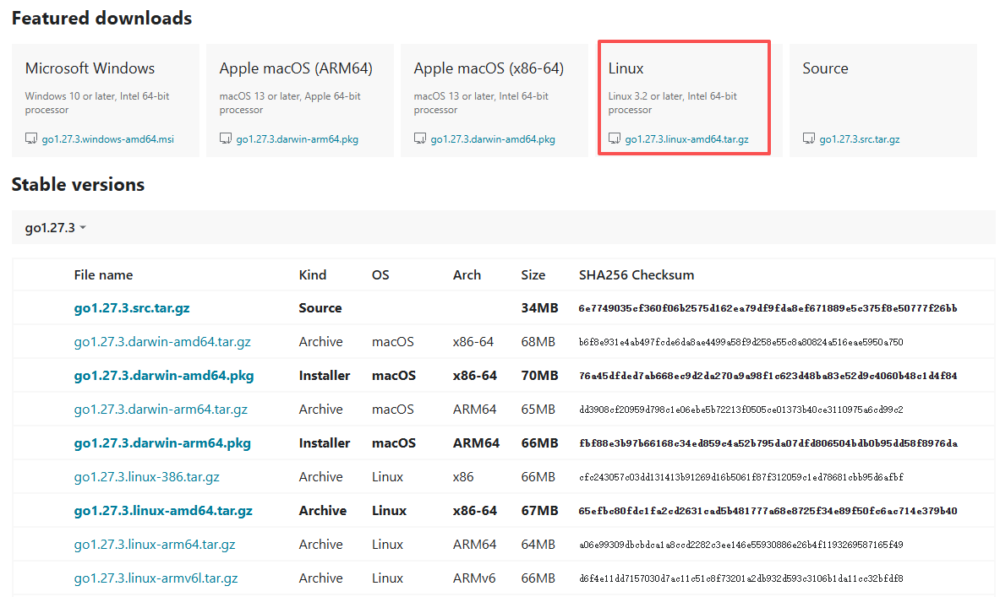

### 下载安装包


```
go1.27.3.linux-amd64.tar.gz
https://golang.google.cn/dl/
[root@localhost ]# tar 
[root@localhost ]# tar -C /usr/local/ -zxvf go1.27.3.linux-amd64.tar.gz
[root@localhost ]# vim /etc/profile
    export PATH=$PATH:/usr/local/go/bin
[root@localhost ]# 
[root@localhost ]# source /etc/profile
[root@localhost ]# go version
    go version go1.27.3 linux/amd64

[root@localhost ]# 


```
