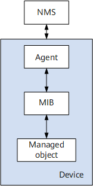
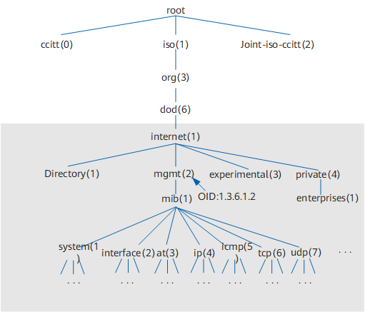
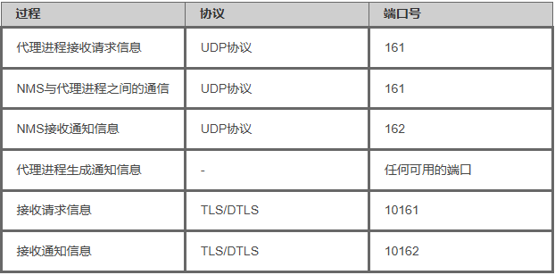

### SMNM协议
SNMP（Simple Network Management Protocol）简单网络管理协议，是TCP/IP协议簇中的应用层协议。SNMP是一种用于网络管理的标准协议，允许网络管理员监控网络上的设备、收集性能统计数据、配置设备以及处理网络中的故障。作为一种通用的网络管理协议，SNMP能够实现对全网中所有设备的集中管理，相比传统的CLI命令行和Web管理方式，具有显著的优势。

它采用“尽可能简单”的设计思想，在设备上添加的软件和硬件、报文的种类和报文的格式都力求简单，因而运行SNMP给设备造成的影响和代价都被最小化。正是因为这种简单性，SNMP得到了众多厂商的广泛欢迎，成为了目前最为广泛的网管协议。SNMP使用用户数据报协议（UDP）来传输其消息，UDP是一种无连接的协议，适用于一些对实时性要求较高、但对数据完整性要求较低的应用场景。

#### 为什么需要SNMP
随着网络技术的飞速发展，网络规模不断扩大，网络设备 数量和种类也越来越多，设备所处位置遍布各地，不同设备厂商提供的管理接口也各不相同。在这种情况下，网络管理员对相关设备的管理维护变得越来越困难。在网络兴起的早期，维护方式就是运维人员蹲在近端对设备进行各种操作，当网络设备越来越多、网络规模越来越大时，管理工作变得单调乏味，近端维护方式几乎不可能实现。

SNMP应运而生，它实现了“利用网络管理网络”的方式。管理员可以利用SNMP平台在网络上的任意节点完成信息查询、信息修改和故障排查等工作，一个运行网管软件的工作站就能对成千上万的网络设备进行监控和信息采集。这些信息可以用来构建网络拓扑或者定位网络中的问题，大幅提高了网络管理效率。SNMP还屏蔽了不同产品之间的差异，实现了不同种类和厂商的网络设备之间的统一管理，使得管理任务与被管理设备的物理特性和网络类型相互独立，管理成本显著降低。

#### SNMP的优点

* 简单性：如其名字所述，这个协议简单易懂，部署的开销成本小，正因为它足够简单，所以被广泛接受，事实上它已经成为主要的网络管理标准。在一个网络设备上实现SNMP的管理比绝大部分其他管理方式都简单直接。

* 通用性：由于采用了标准的UDP协议和基本功能集，SNMP受到了许多网络设备的广泛支持，包括路由器、交换机、打印机、服务器等几乎所有网络设备。SNMP允许管理信息在任意两点之间传送，使得管理员可以从网络中的任何位置检索信息，便于故障排查和性能监测。

* 轻量级：SNMP采用轮询机制，提供最基本的功能集，适合小型、快速、低价格的环境使用。SNMP以UDP报文为承载，因而受到绝大多数设备的支持，同时保证了管理信息在任意两点传送，便于管理员在网络上的任何节点检索信息进行故障排查。

### SNMP系统架构

#### NMS（Network Management Station，网络管理系统）
是整个网络的管理中心，负责对设备进行管理。NMS在网络中扮演管理者角色，是一个采用SNMP协议对网络设备进行管理和监视的系统或软件。NMS可以向设备上的Agent发出请求，查询或修改一个或多个具体的参数值。NMS通常运行专业的网络管理软件，如HP OpenView、SolarWinds、Zabbix、Nagios等，这些软件提供图形化的界面来展示网络设备的状态和性能数据。

#### Agent（代理进程）
是运行在被管理设备上的软件，负责收集设备信息并与NMS进行交互。Agent驻留在设备上，负责统计该节点的各项信息，并且负责与SNMP管理站交互，接收并执行管理站的命令，上传各种本地的网络信息。Agent通过与设备端的MIB进行操作来执行NMS的指令。当Agent检测到网络元素异常时，也可以主动向NMS发送Trap消息，通告当前异常状况。

#### MIB（Management Information Base，管理信息库）
是一组对象的数据库，这些对象定义了网络设备的信息结构。MIB是预先定义好的树形结构库，单个节点代表一个信息，可以囊括网络产品的所有属性，如设备型号、电源状态、接口速率、流量类型等等。MIB是SNMP管理的基础，它定义了在SNMP管理中可以被访问的对象，每个对象都有唯一的标识符OID。

SNMP管理站和SNMP代理之间是松散耦合的关系。它们之间的通信是通过UDP协议完成的，一般情况下使用UDP端口161（Agent监听）和端口162（NMS监听Trap消息）。NMS通过UDP协议向SNMP代理发送各种命令，当SNMP代理收到命令后，返回NMS需要的参数。这种基于请求-响应的模型 是SNMP最基本的工作方式。

SNMP采用轮询机制，NMS定期向设备发送请求（轮询）来获取设备的状态信息，这使得管理系统能够及时了解设备的状况。同时，Agent也可以主动向NMS发送Trap消息，通告检测到的异常事件，这种主动上报机制使得网络管理更加实时和高效。

### SNMP操作类型
#### GET 操作
GET操作用于NMS请求获取Agent的一个或多个对象实例的值。这是SNMP最常用的操作，管理员通过GET操作可以获取设备的各种状态信息，如接口状态、CPU使用率、内存利用率、流量统计等。如果Agent返回GET操作不能提供列表中所有对象实例的值，那么将不会提供任何值。

#### GETNEXT操作
GETNEXT操作是NMS用来从Agent表中获取表中下一个对象实例的值。这个操作主要用于遍历MIB树或表格，管理员可以使用GETNEXT操作逐个获取表中的所有条目，而不需要事先知道具体的OID。GETNEXT操作在SNMPv1和SNMPv2c中都得到支持。

#### SET操作
SET操作用于NMS更改或设置Agent上的对象实例的值。通过SET操作，管理员可以远程配置网络设备的参数，如设置接口状态、修改设备名称、配置告警阈值等。SET操作需要较高的权限，因为它会修改设备的配置。需要注意的是，SET操作采用可写团体名进行认证，而GET和GETNEXT操作采用可读团体名进行认证。

#### TRAP操作
Trap操作用于Agent主动向NMS通告有意义的事件。与GET、GETNEXT、SET操作不同，Trap是Agent主动发送的，不需要NMS先发出请求。这种机制使得网络管理更加实时，当网络设备发生故障或异常时，Agent可以立即向NMS报告。Trap消息通过UDP端口162发送，由于Trap消息为代理主动发送，NMS需要在端口162进行监听。

#### INFORM操作
INFORM操作与TRAP类似，也是用于Agent向NMS通告有意义的事件。两者的主要区别在于：INFORM操作具有确认机制，NMS收到INFORM消息后会返回一个确认响应，而TRAP消息则不需要确认。INFORM操作确保了关键告警消息的可靠传输，适用于需要高可靠性的网络管理场景。INFORM操作在SNMPv2c和SNMPv3中得到支持。

#### GETBULK操作
GETBULK操作是SNMPv2c引入的新操作，用于高效地获取大量的数据。GETBULK操作允许NMS在一个请求中获取多个对象实例的值，大大减少了网络请求的次数，提高了数据获取效率。这对于需要获取大量计数器或表格数据的场景特别有用。

### SNMP版本

#### SNMPv1
SNMPv1是SNMP协议的最初版本，于1988年发布，是SNMP协议的开创性版本。SNMPv1提供最小限度的网络管理功能，其SMI（管理信息结构）和MIB都比较简单。SNMPv1定义了四种协议操作：Get、GetNext、Set和Trap，这些操作构成了SNMP的基础功能集。

SNMPv1的安全性存在明显缺陷，采用团体名（Community ）认证。团体名的作用类似于密码，用来限制NMS对Agent的访问。如果SNMP报文携带的团体名没有得到NMS或Agent的认可，该报文将被丢弃。团体名有可读和可写两种类型，分别用于不同的操作权限控制。然而，SNMPv1的团体名认证是明文传输的，存在严重的安全隐患，容易受到中间人攻击。

SNMPv1报文格式主要包括三个部分：Version（版本号）、Community（团体名）和SNMP PDU（协议数据单元）。Request ID用于匹配请求和响应，SNMP给每个请求分配全局唯一的ID。Error status用于表示在处理请求时出现的状况，Error Index用于指示哪个变量绑定导致了错误。

尽管存在安全缺陷，SNMPv1由于其简单性，仍然广泛应用于各种网络设备中，特别是在一些对安全性要求不高的内部网络环境中。

#### SNMPv2c
SNMPv2，也称为SNMPv2c，是1993年设计的，是v1版的演进版。SNMPv2在v1基础上引入了GETBULK操作，支持批量数据获取，同时优化了协议消息格式（如增加计数器64位支持）。Get、GetNext和Set操作与SNMPv1相同，但增加了GetBulk和Inform两种新的操作类型。

SNMPv2c中的"c"表示“Community-based”，即基于团体的意思。SNMPv2c在功能上进行了扩展，但在安全机制方面仍然依赖v1的共同体字符串，并没有得到实质性改善。因此，SNMPv2c和SNMPv1一样存在明文传输、无加密 等安全缺陷，安全性较低。

SNMPv2c的报文格式与SNMPv1类似，但在一些细节上有所增强。SNMPv2c还引入了更详细的错误状态码，使得错误处理更加精确。尽管安全性没有得到根本改善，SNMPv2c在功能和性能上的改进使其成为应用最广泛的SNMP版本之一，许多网络设备和管理系统都默认使用SNMPv2c。

#### SNMPv3
鉴于SNMPv2c在安全性方面没有得到改善，IETF颁布了SNMPv3版本，提供了基于USM（User Security Model，用户安全模型）的认证加密和基于VACM（View-based Access Control Model，基于视图的访问控制模型）的访问控制。SNMPv3定义在RFC 1905、RFC 1906、RFC 2571、RFC 2572、RFC 2574和RFC 2575中，是迄今为止最安全的SNMP版本。

SNMPv3的安全特性主要包括三个方面：消息认证、加密和访问控制。消息认证使用HMAC-MD5或HMAC-SHA算法，确保消息的完整性和来源可信；加密支持AES和DES算法，可以对消息内容进行加密，防止窃听；访问控制基于VACM模型，可以精细控制不同用户对不同MIB对象的访问权限。

SNMPv3还引入了用户安全模型（USM），支持基于用户的认证和加密。每个用户都有独立的认证密钥和加密密钥，管理员可以灵活配置不同用户的安全级别。SNMPv3还支持时间同步和随机数生成，有效防止重放攻击。

SNMPv3适用于对安全性要求较高的企业级网络环境，特别是涉及敏感数据或跨公网管理的场景。虽然配置相对复杂，但提供的安全保障是前两个版本无法比拟的。建议在生产环境中优先使用SNMPv3，如果设备不支持，则至少使用SNMPv2c，并采取网络隔离等额外的安全措施。

### MIB管理信息库
MIB（Management Information Base，管理信息库）是SNMP管理的核心概念，它是一组对象（Object）的数据库，这些对象定义了网络设备的信息结构。MIB是预先定义好的树形结构库，单个节点代表一个信息，可以囊括网络产品的所有属性，如设备型号、电源状态、接口速率、流量类型等等。

MIB的作用相当于一个字典或数据库，定义了网络设备可以提供的所有管理信息。每个MIB对象都有特定的属性，包括对象名称、对象标识符（OID）、数据类型、访问权限和描述信息等。网络管理系统通过访问MIB来获取设备信息或修改设备配置。

SMI（Structure of Management Information，管理信息结构）指定了在SNMP的MIB中用于定义管理目标的规则。SMI是一种语言，是为了确保网络管理数据的语法和语义明确和无二义性而定义的。SMI定义了数据类型、对象模型，以及写入和读取管理信息的规则。常见的数据类型包括整数型、浮点型、二进制型、IP地址类型等。

#### 公有MIB（Standard MIB） 
是由IETF或相关标准组织定义和管理 MIB，适用于大多数网络设备，具有通用性。公有MIB定义了一系列标准的网络管理对象，如系统信息、接口信息、IP信息、TCP信息、UDP信息等。常见的公有MIB包括：MIB-II（RFC 1213）、IF-MIB、IP-MIB、TCP-MIB、UDP-MIB等。大多数网络设备都支持这些标准的公有MIB。

#### 私有MIB（Enterprise MIB） 
是由设备厂商自定义的MIB，用于管理厂商特有的功能和参数。私有MIB的OID通常以“1.3.6.1.4.1”开头，后面的数字代表不同的厂商。例如，Cisco的私有MIB以"1.3.6.1.4.1.9"开头，华为的私有MIB以"1.3.6.1.4.1.2011"开头。私有MIB允许厂商扩展管理功能，提供更精细的设备管理能力，但不同厂商之间的私有MIB不通用。

### OID对象标识符
OID（Object Identifier，对象标识符）是用于唯一标识MIB树中每个对象的编码。OID采用层次化的树形结构，从根节点开始，逐级向下分配号码。典型的OID格式类似于“1.3.6.1.2.1.5”，每个数字代表树中的一个节点。

例如，"1.3.6.1.2.1.5"代表ICMP节点，在网管软件中获取此节点与子节点的信息，可以得到所有与ICMP有关的信息与操作。常见的系统级OID包括：

* sysDescr（1.3.6.1.2.1.1.1）用于描述设备信息
* sysUpTime（1.3.6.1.2.1.1.3）用于设备运行时间 
* sysContact（1.3.6.1.2.1.1.4）用于设备联系人 
* sysName（1.3.6.1.2.1.1.5）用于设备名称

### SNMP报文格式
#### SNMP报文基本结构
SNMP报文是NMS和Agent之间交换管理信息的基本单元。SNMP报文的基本格式包括三个主要部分：版本号（Version）、团体名（Community）和SNMP协议数据单元（PDU）。
* Version字段 表示SNMP协议的版本号，SNMPv1为0，SNMPv2c为1，SNMPv3为2或3（取决于安全级别）。

* Community字段 是团体名，用于Agent与NMS之间的认证。团体名有可读和可写两种类型：执行Get、GetNext操作时采用可读团体名进行认证；执行Set操作时采用可写团体名进行认证。如果SNMP报文携带的团体名没有得到NMS或Agent的认可，该报文将被丢弃。

* SNMP PDU 是协议数据单元，包含具体的操作请求或响应数据。PDU的类型包括GetRequest、GetNextRequest、SetRequest、GetResponse、Trap等。

#### PDU类型详解
GetRequest PDU 用于NMS向Agent请求获取一个或多个对象实例的值。PDU中包含Variable Bindings列表，列出需要获取的对象OID。

GetNextRequest PDU 用于获取表中下一个对象实例的值，常用于遍历MIB树或表格。

SetRequest PDU 用于NMS设置Agent上对象实例的值，包含要设置的对象OID和新的值。

GetResponse PDU 是Agent对GetRequest、GetNextRequest或SetRequest的响应，包含请求的操作结果和对象值。

Trap PDU 是Agent主动向NMS发送的告警消息，用于报告异常事件。Trap PDU包括Enterprise（企业标识）、Agent Address（代理地址）、Generic Trap（通用Trap类型）、Specific Trap（特定Trap类型）、Time Timestamp（时间戳）等字段。

GetBulkRequest PDU（SNMPv2c及以上）是GetRequest的增强版，可以在一个请求中获取大量的数据，提高数据获取效率。

InformRequest PDU（SNMPv2c及以上）与Trap类似，但需要接收方确认，确保消息可靠传输。

#### PDU通用字段
各种PDU类型共享一些通用字段，这些字段在理解和调试SNMP通信时非常重要。

Request ID 用于匹配请求和响应，SNMP给每个请求分配全局唯一的ID。当NMS发送请求时，会设置一个Request ID，Agent在响应时会返回相同的ID，这样NMS可以将响应与请求对应起来。

Error Status 用于表示在处理请求时出现的状况。常见的错误状态包括：noError（0）表示没有错误，tooBig（1）表示响应太大无法封装，noSuchName（2）表示请求的对象不存在，badValue（3）表示设置的值无效，readOnly（4）表示对象不可写，genErr（5）表示其他错误。

Error Index 用于指示哪个变量绑定（Variable Binding）导致了错误。当Error Status为非零值时，Error Index指向出错的对象在Variable Bindings列表中的位置。

Variable Bindings 是对象名和对象值的列表。对于Get和Set操作，Variable Bindings列出要获取或设置的对象及其值；对于响应操作，Variable Bindings包含请求的对象及其当前值或错误信息。

#### SNMP端口

SNMP端口是SNMP通信端点，SNMP消息传输通过UDP进行，通常使用UDP端口号161/162。有时也使用传输层安全性（TLS）或数据报传输层安全性（DTLS）协议，端口使用情况如下表所示。
### SNMP配置基础
#### 设备端配置概述
在网络设备上配置SNMP主要包括以下几个方面：启用SNMP服务、配置团体名（Community）、配置SNMP版本、配置Trap功能等。不同厂商的设备配置命令略有不同，但基本概念是相似的。

以华为设备为例，配置SNMP的基本步骤包括：全局启用SNMP功能、配置团体名（设置读写权限）、配置SNMP版本（根据需要选择v1、v2c或v3）、配置Trap目标主机（NMS的IP地址）、配置Trap相关参数等。

#### SNMP团体名配置
团体名（Community）是SNMPv1和SNMPv2c的认证凭证，类似于密码。在配置团体名时，需要分别配置只读（Read-Only）团体名和读写（Read-Write）团体名。只读团体名用于GET和GETNEXT操作，写团体名用于SET操作。

团体名配置时需要注意安全性：不应使用默认的团体名（如public、private），应使用复杂的字符串；应在网络边界控制SNMP访问，只允许可信的NMS访问；建议使用SNMPv3替代v1/v2c以获得更好的安全性。

#### SNMPv3配置要点
SNMPv3的配置相对复杂，需要配置用户名、认证协议、加密协议等信息。主要配置项包括：

用户配置：创建SNMPv3用户，指定用户名、认证协议（MD5或SHA）、认证密码、加密协议（AES或DES）、加密密码等。

视图配置：定义MIB视图，控制用户可以访问的MIB对象范围。

访问控制配置：将用户与视图关联，配置读写权限。

安全级别配置：选择安全级别，包括noAuthNoPriv（无认证无加密）、authNoPriv（有认证无加密）、authPriv（有认证有加密）。

#### 常见配置错误与排查
SNMP配置中常见的错误包括：团体名不匹配、SNMP版本不一致、防火墙阻止UDP端口161/162、ACL限制等。排查时可以按照以下步骤进行：

首先确认SNMP服务已启用，检查设备SNMP配置是否正确；其次确认NMS与Agent之间的网络连通性，检查UDP端口161/162是否被防火墙阻止；然后验证团体名和SNMP版本是否匹配；最后使用snmpwalk等工具进行测试，逐步定位问题。

### SNMP工具与使用
#### 常用SNMP命令行工具
SNMP提供了一系列命令行工具，用于测试和调试SNMP通信。以下是一些最常用的工具：
snmpget：用于获取单个对象的值。基本用法：snmpget -v 2c -c public 192.168.1.1 sysDescr.0
snmpgetnext：用于获取下一个对象实例的值，常用于MIB树遍历。
snmpwalk：用于遍历整个MIB树或指定节点下的所有对象。基本用法：snmpwalk -v 2c -c public 192.168.1.1
snmpset：用于设置对象实例的值，需要读写权限的团体名。
snmptrap：用于模拟发送Trap消息，用于测试Trap接收功能。
snmpbulkget：使用GETBULK操作获取大量数据，提高效率。
snmpbulkwalk：使用GETBULK操作遍历MIB树，比snmpwalk更高效。
#### 工具参数说明
常用的snmpwalk参数包括：
-v：指定SNMP版本，如1、2c、3。
-c：指定团体名（Community string）。
-t：设置超时时间（秒）。
-r：设置重试次数。
-On：以数字形式显示OID，而不是名称。
-Ov：只显示值，不显示OID。
#### MIB浏览器
MIB浏览器是图形化的SNMP管理工具，可以方便地浏览MIB树、查看对象定义、获取和设置对象值。常见的MIB浏览器包括：iReasoning MIB Browser、ManageEngine MIB Browser、SnmpB等。这些工具通常需要加载MIB文件才能正确解析对象名称。

### SNMP安全最佳实践
#### 安全风险分析
SNMP协议设计之初主要考虑的是简单性和实用性，安全性并非首要目标，因此存在多个安全风险。SNMPv1和SNMPv2c使用明文传输团体名，攻击者可以通过网络嗅探获取团体名，进而获取或修改设备信息。SNMP使用的UDP协议是无连接的，无法验证数据来源，容易受到IP欺骗和中间人攻击。此外，SNMP的默认团体名（如public、private）广为人知，如果不修改将极易被攻击。

#### 安全加固建议
为了提高SNMP的安全性，建议采取以下措施：

升级到SNMPv3：尽可能使用SNMPv3，它提供了消息认证和加密功能，是最安全的SNMP版本。

修改默认团体名：如果必须使用SNMPv1/v2c，必须修改默认的团体名，使用复杂的字符串。

使用ACL控制访问：在设备上配置访问控制列表（ACL），只允许可信的NMS IP地址访问SNMP端口。

网络隔离：将SNMP流量放在专用的管理网络中，与业务流量隔离。

禁用SNMPv1/v2c：如果设备支持，禁用SNMPv1和SNMPv2c，只启用SNMPv3。

监控SNMP日志：定期检查SNMP日志，监控异常访问尝试。

使用防火墙：在网络边界使用防火墙控制SNMP访问，只开放必要的端口。

### SNMP应用场景
#### 网络监控
SNMP最常见的应用场景是网络监控。通过SNMP，管理员可以实时监控网络设备的运行状态、性能指标和流量数据。网络监控系统（如Zabbix、Nagios、PRTG、SolarWinds等）通过SNMP定期轮询网络设备，获取接口状态、CPU使用率、内存利用率、磁盘空间、流量计数等信息，并在发现异常时发送告警通知。

网络监控可以帮助管理员及时发现网络故障，预测潜在问题，优化网络性能。通过分析SNMP采集的历史数据，管理员可以了解网络流量趋势，做出 capacity规划决策。

#### 设备配置管理
除了监控，SNMP还可以用于远程配置网络设备。通过SET操作，管理员可以远程修改设备的配置参数，如VLAN设置、端口速率、STP参数等。这种能力使得大规模网络设备的批量配置成为可能，提高了网络管理效率。

需要注意的是，SET操作需要较高的权限，应严格控制具有SET权限的用户和团体名，避免未授权的配置更改。

#### 故障管理
SNMP的Trap机制在故障管理中发挥着重要作用。当网络设备发生故障或异常时（如接口down、CPU过载、内存不足等），Agent可以主动向NMS发送Trap消息，报告故障事件。这种主动告警机制使得故障响应更加及时，缩短了故障修复时间。

结合告警规则和自动化响应脚本，管理员可以实现故障的自动处理，进一步提高网络可用性。

#### 性能管理
通过SNMP采集的性能数据可以用于网络性能分析和管理。管理员可以分析接口流量、误码率、延迟、抖动等指标，评估网络性能状况，识别性能瓶颈。SNMP计数器（如ifInOctets、ifOutOctets等）提供的统计数据是性能分析的重要依据。

### SNMP常见问题汇总
#### 为什么无法获取SNMP数据
无法获取SNMP数据的常见原因包括：SNMP服务未在设备上启用、设备IP地址不可达、防火墙阻止了UDP端口161/162、团体名不匹配或错误、SNMP版本不一致、OID不存在或无法访问等。排查时应逐项检查，从网络连通性开始，到SNMP配置，再到具体的权限和参数。

#### SNMP响应缓慢怎么办
SNMP响应缓慢可能由多种原因导致：网络延迟或拥塞、设备CPU负载过高、SNMP请求超时设置不当、大量数据请求导致处理缓慢等。优化措施包括：增加超时时间和重试次数、减少单次请求的数据量、使用GetBulk操作代替多个Get请求、优化网络路径、在设备上配置SNMP优化参数等。

#### 如何选择SNMP版本
选择SNMP版本时需要考虑安全性要求和设备兼容性。如果设备支持且安全性要求较高，应优先选择SNMPv3；如果设备不支持SNMPv3或需要与老旧系统兼容，可以使用SNMPv2c，但应采取额外的安全措施（如ACL、网络隔离）；尽量避免使用SNMPv1，除非完全必要。

#### SNMP与端口的关系
SNMP使用UDP协议进行通信，默认使用两个端口：端口161用于Agent监听NMS的请求，端口162用于NMS监听Agent的Trap消息。UDP是无连接的协议，相比TCP更轻量，适合SNMP这种请求-响应模式的通信。需要注意的是，防火墙需要同时开放这两个端口才能保证SNMP通信正常。
