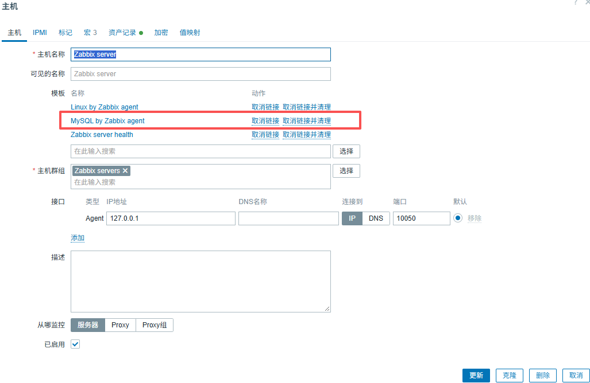
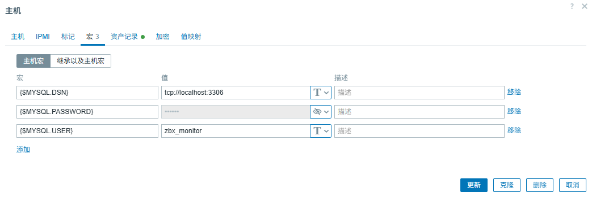
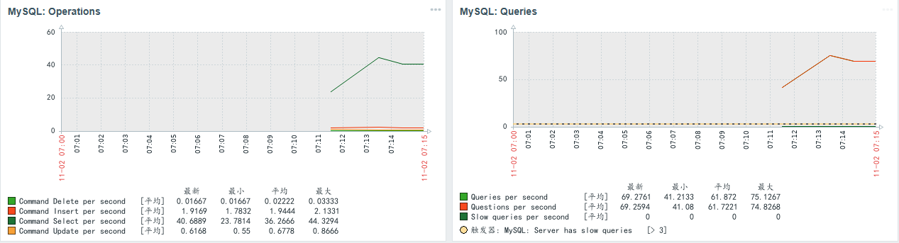
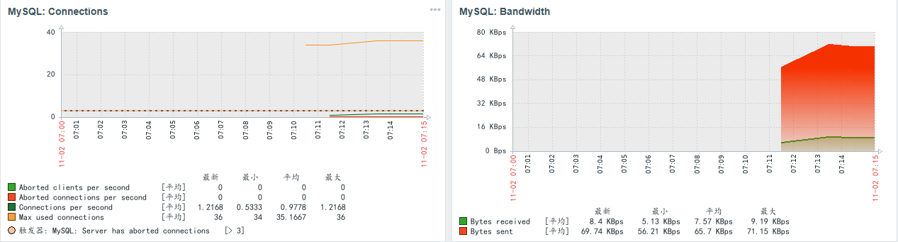
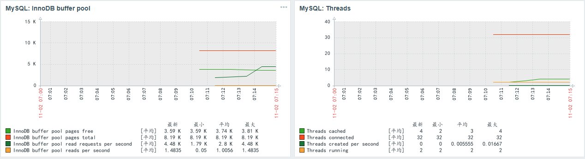

### 创建主机
创建主机，选择MySQL by Zabbix agent模板。





### 创建mysql账号
```
CREATE USER 'zbx_monitor'@'%' IDENTIFIED BY 'Zbx@123456';
GRANT REPLICATION CLIENT,PROCESS,SHOW DATABASES,SHOW VIEW ON *.* TO 'zbx_monitor'@'%';
flush privileges;

```

### 配置zabbix-agent

```
[root@localhost ~]# cd /usr/local/zabbix/etc/zabbix_agentd.conf.d
[root@localhost ~]# vim template_db_mysql.conf
    #原配置文件
    UserParameter=mysql.ping[*], mysqladmin -h"$1" -P"$2" ping
    UserParameter=mysql.get_status_variables[*], mysql -h"$1" -P"$2" -sNX -e "show global status"
    UserParameter=mysql.version[*], mysqladmin -s -h"$1" -P"$2" version
    UserParameter=mysql.db.discovery[*], mysql -h"$1" -P"$2" -sN -e "show databases"
    UserParameter=mysql.dbsize[*], mysql -h"$1" -P"$2" -sN -e "SELECT SUM(DATA_LENGTH + INDEX_LENGTH) FROM INFORMATION_SCHEMA.TABLES WHERE TABLE_SCHEMA='$3'"
    UserParameter=mysql.replication.discovery[*], mysql -h"$1" -P"$2" -sNX -e "show slave status"
    UserParameter=mysql.slave_status[*], mysql -h"$1" -P"$2" -sNX -e "show slave status"
    
    #修改为
    UserParameter=mysql.ping[*],HOME=/var/lib/zabbix mysqladmin -h"$1" -P"$2" ping
    UserParameter=mysql.get_status_variables[*],HOME=/var/lib/zabbix mysql -h"$1" -P"$2" -sNX -e "show global status"
    UserParameter=mysql.version[*],HOME=/var/lib/zabbix mysqladmin -s -h"$1" -P"$2" version
    UserParameter=mysql.db.discovery[*],HOME=/var/lib/zabbix mysql -h"$1" -P"$2" -sN -e "show databases"
    UserParameter=mysql.dbsize[*],HOME=/var/lib/zabbix mysql -h"$1" -P"$2" -sN -e "SELECT SUM(DATA_LENGTH + INDEX_LENGTH) FROM INFORMATION_SCHEMA.TABLES WHERE TABLE_SCHEMA='$3'"
    UserParameter=mysql.replication.discovery[*],HOME=/var/lib/zabbix mysql -h"$1" -P"$2" -sNX -e "show slave status"
    UserParameter=mysql.slave_status[*],HOME=/var/lib/zabbix mysql -h"$1" -P"$2" -sNX -e "show slave status"
[root@localhost ~]# chmod -x template_db_mysql.conf
[root@localhost ~]# chown zabbix:zabbix template_db_mysql.conf
[root@localhost ~]# 
[root@localhost ~]# vim /var/lib/zabbix/.my.cnf
    [client]
    user='zbx_monitor'
    password='Zbx@123456'
[root@localhost ~]# 

```


### 查看监测指标





### 常见错误
Preprocessing failed for: mysql: [Warning] Using a password on the command line interface can be insecure..<?xml version="1...
1. Failed: cannot extract XML value with xpath "/resultset/row[field/text()='Aborted_connects']/field[@name='Value']/text()": cannot parse xml value from data of length 56472 bytes: Start tag expected, '<' not found

 Failed: cannot extract XML value with
指定 libxml2 重新编译
 ./configure \
      --prefix=/usr/local/zabbix \
      --enable-server \
      --enable-agent \
      --with-mysql \
      --with-net-snmp \
      --with-libcurl \
      --with-ssl \
      --with-libxml2 \

Preprocessing failed for: ERROR 1045 (28000): Access denied for user 'zabbix'@'localhost' (using password: NO)

用户名密码没有指定，可能是/var/lib/zabbix/.my.cnf

