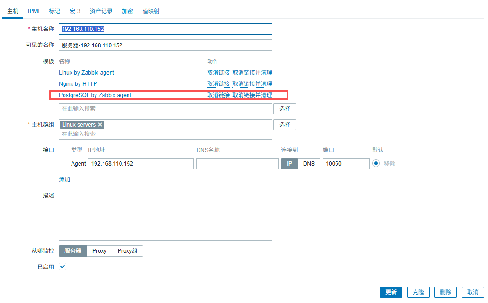
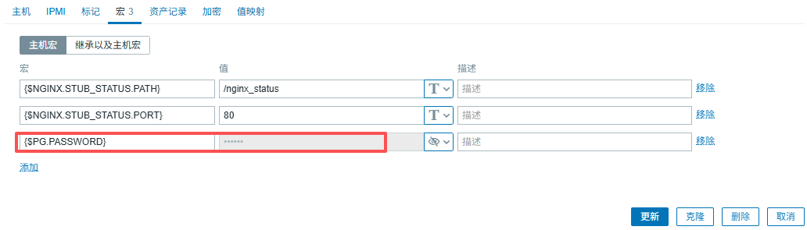
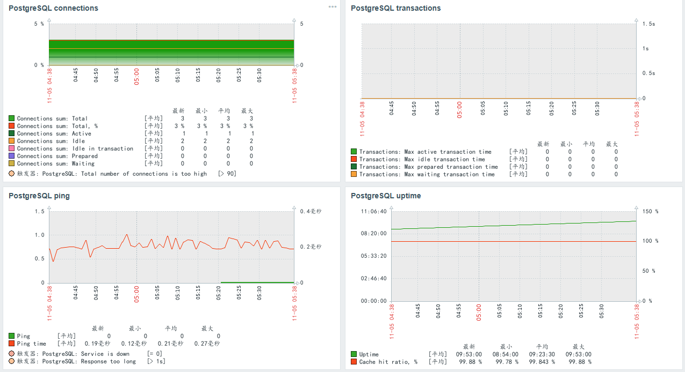

### 创建pgsql监控用户

PostgreSQL 10 及以上版本（推荐，利用内置的 pg_monitor 预定义角色）：
```
CREATE USER zbx_monitor WITH PASSWORD '<PASSWORD>' INHERIT;
GRANT pg_monitor TO zbx_monitor;
sql
PostgreSQL 9.6 及以下版本：

CREATE USER zbx_monitor WITH PASSWORD '<PASSWORD>';
GRANT SELECT ON pg_stat_database TO zbx_monitor;
```
-- 若要采集 WAL 指标，该用户必须拥有 superuser 角色。
ALTER USER zbx_monitor WITH SUPERUSER;
sql
从源码看，pg_monitor 角色之所以够用，是因为查询包主要读取 pg_stat_* 系统统计视图、pg_ls_waldir() 等函数；而 9.6 时代没有 pg_monitor，只能退而求其次显式授权，WAL 相关视图（如 pg_stat_wal、目录扫描函数）需要更高权限。 


### 创建pgsql脚本

```
[root@localhost ]# cd /usr/local/zabbix/etc/zabbix_agentd.conf.d/
[root@localhost ]# vim template_db_postgresql.conf 
    UserParameter=pgsql.userparam.revision, echo 2

    UserParameter=pgsql.bgwriter[*], psql -qtAX postgresql://"$3":"$4"@"$1":"$2"/"$5" -f "/var/lib/zabbix/postgresql/pgsql.bgwriter.sql"

    UserParameter=pgsql.connections.sum[*], psql -qtAX postgresql://"$3":"$4"@"$1":"$2"/"$5" -f "/var/lib/zabbix/postgresql/pgsql.connections.sum.sql"

    UserParameter=pgsql.dbstat[*], psql -qtAX postgresql://"$3":"$4"@"$1":"$2"/"$5" -f "/var/lib/zabbix/postgresql/pgsql.dbstat.sql"

    UserParameter=pgsql.transactions[*], psql -qtAX postgresql://"$3":"$4"@"$1":"$2"/"$5" -f "/var/lib/zabbix/postgresql/pgsql.transactions.sql"
    UserParameter=pgsql.config.hash[*], psql -qtAX postgresql://"$3":"$4"@"$1":"$2"/"$5" -f "/var/lib/zabbix/postgresql/pgsql.config.hash.sql"
    UserParameter=pgsql.wal.stat[*], psql -qtAX postgresql://"$3":"$4"@"$1":"$2"/"$5" -f "/var/lib/zabbix/postgresql/pgsql.wal.stat.sql"
    UserParameter=pgsql.locks[*], psql -qtAX postgresql://"$3":"$4"@"$1":"$2"/"$5" -f "/var/lib/zabbix/postgresql/pgsql.locks.sql"
    UserParameter=pgsql.queries[*], psql -qtAX postgresql://"$3":"$4"@"$1":"$2"/"$5" -v tmax=$6 -f "/var/lib/zabbix/postgresql/pgsql.query.time.sql"
    UserParameter=pgsql.uptime[*], psql -qtAX postgresql://"$3":"$4"@"$1":"$2"/"$5" -f "/var/lib/zabbix/postgresql/pgsql.uptime.sql"
    UserParameter=pgsql.cache.hit[*], psql -qtAX postgresql://"$3":"$4"@"$1":"$2"/"$5" -f "/var/lib/zabbix/postgresql/pgsql.cache.hit.sql"
    UserParameter=pgsql.scans[*], psql -qtAX postgresql://"$3":"$4"@"$1":"$2"/"$5" -f "/var/lib/zabbix/postgresql/pgsql.scans.sql"
    UserParameter=pgsql.frozenxid[*], psql -qtAX postgresql://"$3":"$4"@"$1":"$2"/"$5" -f "/var/lib/zabbix/postgresql/pgsql.frozenxid.sql"

    UserParameter=pgsql.stat.wal[*], psql -qtAX postgresql://"$3":"$4"@"$1":"$2"/"$5" -f "/var/lib/zabbix/postgresql/pgsql.stat.wal.sql"
    UserParameter=pgsql.relation.size[*], psql -qtAX postgresql://"$3":"$4"@"$1":"$2"/"$5" -f "/var/lib/zabbix/postgresql/pgsql.relation.size.sql"
    UserParameter=pgsql.tablespace.size[*], psql -qtAX postgresql://"$3":"$4"@"$1":"$2"/"$5" -f "/var/lib/zabbix/postgresql/pgsql.tablespace.size.sql"
    UserParameter=pgsql.stat.io[*], psql -qtAX postgresql://"$3":"$4"@"$1":"$2"/"$5" -f "/var/lib/zabbix/postgresql/pgsql.stat.io.sql"
    UserParameter=pgsql.stat.slru[*], psql -qtAX postgresql://"$3":"$4"@"$1":"$2"/"$5" -f "/var/lib/zabbix/postgresql/pgsql.stat.slru.sql"
    UserParameter=pgsql.subscription.stats[*], psql -qtAX postgresql://"$3":"$4"@"$1":"$2"/"$5" -f "/var/lib/zabbix/postgresql/pgsql.subscription.stats.sql"

    UserParameter=pgsql.discovery.db[*], psql -qtAX postgresql://"$3":"$4"@"$1":"$2"/"$5" -f "/var/lib/zabbix/postgresql/pgsql.discovery.db.sql"
    UserParameter=pgsql.db.size[*], psql -qtAX postgresql://"$3":"$4"@"$1":"$2"/"$5" -c "SELECT pg_database_size('$6')"
    UserParameter=pgsql.ping[*], pg_isready -h "$1" -p "$2"
    UserParameter=pgsql.ping.time[*], LC_ALL=C.UTF-8 psql -qtAX postgresql://"$3":"$4"@"$1":"$2"/"$5" -f "/var/lib/zabbix/postgresql/pgsql.ping.time.sql"
    UserParameter=pgsql.version[*], psql -qtAX postgresql://"$3":"$4"@"$1":"$2"/"$5" -c "SELECT version();"

    UserParameter=pgsql.replication.count[*], psql -qtAX postgresql://"$3":"$4"@"$1":"$2"/"$5" -c "SELECT count(*) FROM pg_stat_replication"
    UserParameter=pgsql.replication.recovery_role[*], psql -qtAX postgresql://"$3":"$4"@"$1":"$2"/"$5" -f "/var/lib/zabbix/postgresql/pgsql.replication.recovery_role.sql"
    UserParameter=pgsql.replication.lag.sec[*], psql -qtAX postgresql://"$3":"$4"@"$1":"$2"/"$5" -f "/var/lib/zabbix/postgresql/pgsql.replication.lag.sql"
    UserParameter=pgsql.replication.status[*], psql -qtAX postgresql://"$3":"$4"@"$1":"$2"/"$5" -f "/var/lib/zabbix/postgresql/pgsql.replication.status.sql"
    UserParameter=pgsql.replication.slots[*], psql -qtAX postgresql://"$3":"$4"@"$1":"$2"/"$5" -f "/var/lib/zabbix/postgresql/pgsql.replication.slots.sql"
[root@localhost ]# 
[root@localhost ]# chown zabbix:zabbix template_db_postgresql.conf 
[root@localhost ]# mkdir /var/lib/zabbix/postgresql/
    pgsql.bgwriter.sql
    pgsql.cache.hit.sql
    pgsql.config.hash.sql
    pgsql.connections.sum.sql
    pgsql.dbstat.sql
    pgsql.discovery.db.sql
    pgsql.frozenxid.sql
    pgsql.locks.sql
    pgsql.ping.time.sql
    pgsql.query.time.sql
    pgsql.relation.size.sql
    pgsql.replication.lag.sql
    pgsql.replication.recovery_role.sql
    pgsql.replication.slots.sql
    pgsql.replication.status.sql
    pgsql.scans.sql
    pgsql.stat.io.sql
    pgsql.stat.slru.sql
    pgsql.stat.wal.sql
    pgsql.subscription.stats.sql
    pgsql.tablespace.size.sql
    pgsql.transactions.sql
    pgsql.uptime.sql
    pgsql.wal.stat.sql
[root@localhost ]# chown -R zabbix:zabbix /var/lib/zabbix/postgresql/
[root@localhost ]#  
[root@localhost ]# systemctl restart zabbix_agent
[root@localhost ]#  
[root@localhost ]#  
[root@localhost ]#  

```

[zabbix-templates-db-postgresql_agent-postgresql.zip]('./assets/zabbix-templates-db-postgresql_agent-postgresql.zip' "超链接title")


### zabbix-web配置








### 监控指标

|	宏名	|	说明	|	默认值	|
|	----	|	----	|	----	|
|	{$PG.HOST}	|	PostgreSQL 主机名或 IP	|	localhost	|
|	{$PG.PORT}	|	PostgreSQL 服务端口	|	5432	|
|	{$PG.USER}	|	PostgreSQL 用户名	|	zbx_monitor	|
|	{$PG.PASSWORD}	|	PostgreSQL 用户密码	|	（空）	|
|	{$PG.DATABASE}	|	默认连接数据库	|	postgres	|
|	{$PG.LLD.FILTER.DBNAME}	|	可发现数据库的过滤正则	|	.+	|
|	{$PG.LLD.FILTER.SCHEMA}	|	可发现 Schema 的过滤正则	|	.+	|
|	{$PG.LLD.FILTER.SUBSCRIPTION}	|	可发现逻辑复制订阅的过滤正则	|	.+	|
|	{$PG.LLD.FILTER.TABLESPACE}	|	可发现表空间的过滤正则	|	.+	|
|	{$PG.CACHE_HITRATIO.MIN.WARN}	|	缓存命中率最低告警阈值（%）	|	90	|
|	{$PG.CHECKPOINTS_REQ.MAX.WARN}	|	请求型检查点最高频率告警阈值	|	5	|
|	{$PG.CONFLICTS.MAX.WARN}	|	恢复冲突数最高告警阈值	|	0	|
|	{$PG.CONN_TOTAL_PCT.MAX.WARN}	|	连接数占 max_connections 的最高百分比告警阈值	|	90	|
|	{$PG.DEADLOCKS.MAX.WARN}	|	检测到的死锁数最高告警阈值	|	0	|
|	{$PG.FROZENXID_PCT_STOP.MIN.HIGH}	|	距冻结 XID 停机点的最小百分比（严重）阈值	|	75	|
|	{$PG.IO.CACHE.MIN.WARN}	|	共享缓冲区命中率最低告警阈值（%）	|	90	|
|	{$PG.LOCKS.MAX.WARN}	|	锁数量最高告警阈值	|	100	|
|	{$PG.PING_TIME.MAX.WARN}	|	连接响应时间上限（用于触发器）	|	1s	|
|	{$PG.QUERY_EXECUTION_TIME.MAX.WARN}	|	慢查询执行时间阈值（秒）	|	30	|
|	{$PG.REPLICATION.SLOTS.RETAINING.MAX.HIGH}	|	保留 WAL 的非活跃复制槽数量上限（严重）	|	2	|
|	{$PG.REPLICATION.SLOTS.RETAINING.MAX.WARN}	|	保留 WAL 的非活跃复制槽数量上限（警告）	|	1	|
|	{$PG.REPL_LAG.MAX.WARN}	|	复制延迟上限	|	10m	|
|	{$PG.SLOW_QUERIES.MAX.WARN}	|	慢查询数量触发阈值	|	5	|
|	{$PG.SLRU.CACHE.MIN.HIGH}	|	SLRU 缓存命中率最低严重阈值（%）	|	95	|
|	{$PG.SLRU.CACHE.MIN.WARN}	|	SLRU 缓存命中率最低告警阈值（%）	|	98	|
|	{$PG.SUBSCRIPTION.ERRORS.MAX.WARN}	|	逻辑复制订阅错误数上限	|	2	|
|	{$PG.TABLESPACE.SIZE.MAX.HIGH}	|	表空间大小上限（严重）	|	15G	|
|	{$PG.TABLESPACE.SIZE.MAX.WARN}	|	表空间大小上限（警告）	|	5G	|
|	{$PG.WAL.BUFFERS_FULL.MAX.WARN}	|	每秒 WAL 缓冲区耗尽次数上限	|	10	|

### 常见报错
```
zabbix Preprocessing failed for: sh: psql:未找到命令
ln -s /usr/local/pgsql/bin/psql /usr/local/bin/psql

```